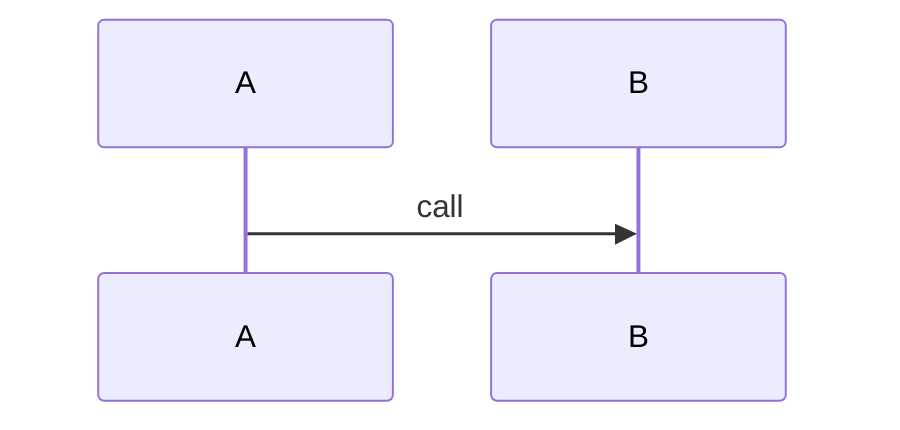

# NS3-NNN: {one-line title: what breaks}

<!-- Copy to ns3-rcapa-<short-description>.md. README.md in this directory says
what each section must answer. Delete these comments. -->

## Summary

| | |
|---|---|
| ID | NS3-NNN |
| RCAPA ticket | [#N](https://github.com/swarm-routing/ns3-tools/issues/N): `[rcapa] NS3-NNN {short description}` |
| Status | open upstream / draft ready / reported / worked around / fixed in ns-3.X |
| Found | YYYY-MM-DD, in {repo}#N |
| Last checked | YYYY-MM-DD (what was checked: a re-run, a source read, the upstream thread) |
| ns-3 versions | run: …; read: …; not affected: … |
| Modules | … |
| Impact on our repositories | which arms, gates, campaigns or numbers it touches |
| Upstream | link, or "not yet reported" |

{two or three sentences: the defect and its effect.}

## Problem and detection

{What goes wrong, the symptom we saw, and how it was detected: the run, the
job, the issue.}

## Reproduction

```bash
# exact commands
```

- Image: `ghcr.io/swarm-routing/ns3-dev:{tag}@sha256:{digest}` (both required: a tag can move; until the digest is known write `sha256: pending` and record it on the RCAPA ticket)
- Seed / RngRun: …
- Expected: …
- Actual: …
- Minimal program: {link at a commit SHA}

## Root cause: five whys

1. **Why …?** … (evidence: `src/…:NNN`, ns-3.X; or a run, a comment)
2. **Why …?** …
3. **Why …?** …
4. **Why …?** …
5. **Why …?** …

## Diagrams

### Failing call chain



### ns-3 types involved


## Source excerpts

`src/{module}/model/{file}.cc:NNN–MMM`, ns-3.X:

```cpp
// a short quote
```

## Corrective actions (ours)

| Action | Where | Status |
|--------|-------|--------|
| … | swarm-routing/{repo}#N | done / open |

## Preventive actions

| Action | Where | Status |
|--------|-------|--------|
| … | … | done / open (issue) |

## Upstream report

Status: … The maintainer files upstream reports under their own account.

> **Title:** …
>
> …

## Timeline

| Date | Event |
|------|-------|
| YYYY-MM-DD | … |

## Links

- …
