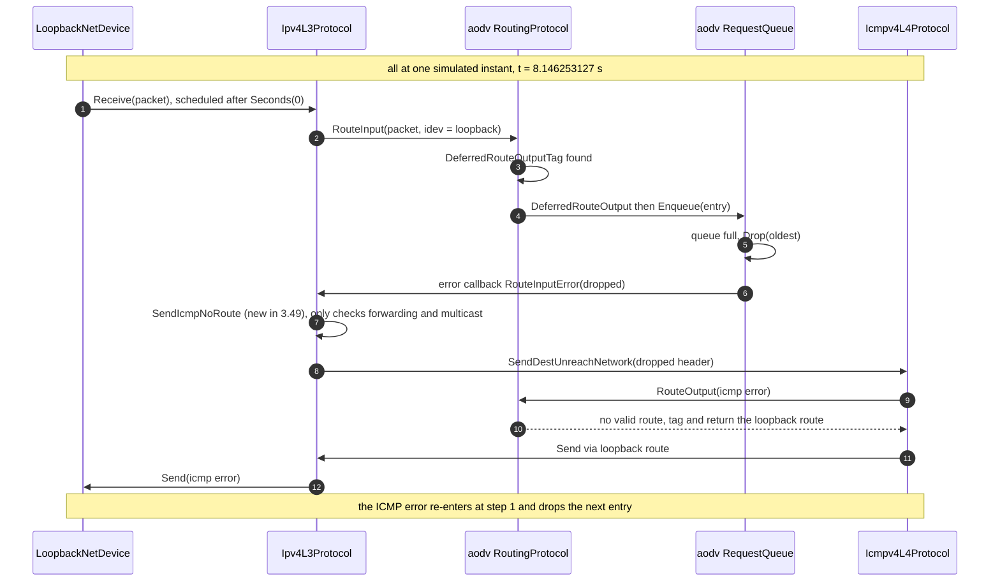
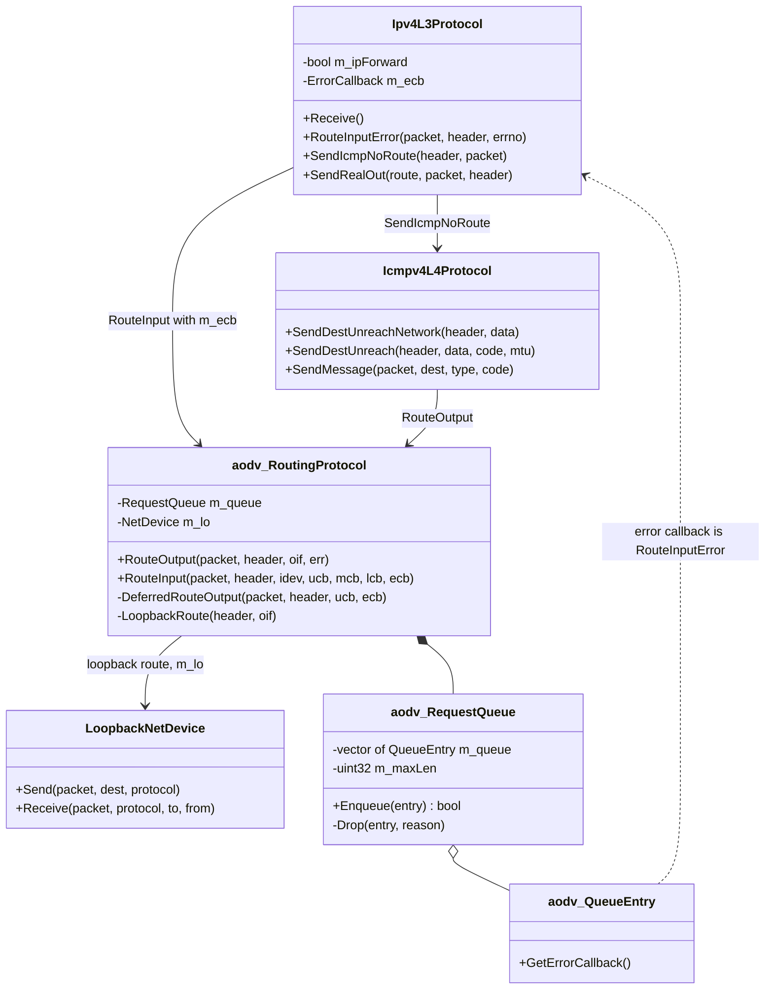
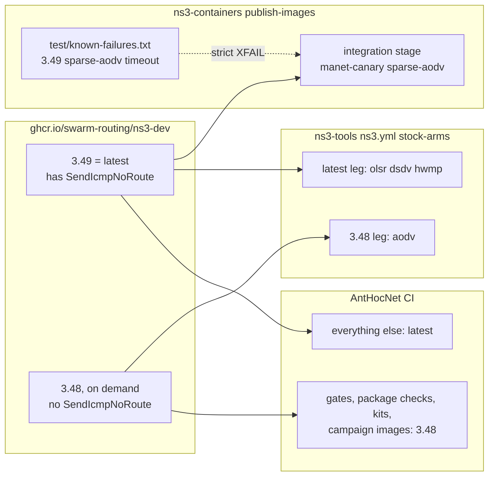

# NS3-001: ns-3.49 AODV livelocks in a zero-time ICMP "net unreachable" storm

## Summary

| | |
|---|---|
| ID | NS3-001 |
| RCAPA ticket | [#238](https://github.com/swarm-routing/ns3-tools/issues/238) |
| Status | open upstream; draft ready, not yet reported; worked around (3.48 pin) |
| Found | 2026-10-15 on ns-3-dev ([swarm-routing/AntHocNet#656](https://github.com/swarm-routing/AntHocNet/issues/656)); 2026-11-01 on ns-3.49 ([swarm-routing/AntHocNet#843](https://github.com/swarm-routing/AntHocNet/issues/843), [swarm-routing/ns3-containers#35](https://github.com/swarm-routing/ns3-containers/issues/35)) |
| Last checked | 2026-11-16: reproduced on ns-3-dev `master` `8ec9b4a1` ([comment](https://github.com/swarm-routing/ns3-containers/issues/55#issuecomment-6904704191)); ns-3.49 and ns-3.48 sources read at their tags for this page; nsnam GitLab searched for `SendIcmpNoRoute` (no issue) |
| ns-3 versions | run: 3.49 (hangs), 3.48 (finishes), ns-3-dev `230ea2a3` of 2026-10-08 (hangs), ns-3-dev `master` `8ec9b4a190b52dadb5a3c35572dec687e1b75379` of 2026-11-11 (hangs, run 2026-11-16); not affected: 3.48 and earlier (no `SendIcmpNoRoute`) |
| Modules | `internet` (`Ipv4L3Protocol`, `Icmpv4L4Protocol`, `LoopbackNetDevice`), `aodv` (`RoutingProtocol`, `RequestQueue`) |
| Impact on our repositories | on 3.49, a run of stock `aodv` or an AODV-derived arm (AntHocNet's vendored `aomdv`) never finishes once AODV's request queue drops a packet, which needs the network to stay partitioned long enough (a short run can finish first: `--time=5` does). Affected: ns3-tools' `aodv` arm check, AntHocNet's gates, package checks, kits and campaigns, ARA's and BeeAdHoc's AODV comparisons. Protocols that do not use AODV are unaffected. |
| Upstream | not yet reported; draft in [swarm-routing/ns3-containers#55](https://github.com/swarm-routing/ns3-containers/issues/55) |

ns-3.49 answers every routing failure of a forwarding node with an ICMP
Destination Unreachable, including AODV's request-queue drops. In a partitioned
network the ICMP error has no route either, so AODV queues it into the same full
queue through the loopback device, the queue drops another packet, and that drop
raises another ICMP error, at the same simulated instant, without end.

## Problem and detection

**Symptom.** Simulated time stops at one instant and the process spins at 100 %
CPU until it is killed. No error, no output after the last line printed.

**How it was detected.**

1. 2026-10-15: AntHocNet's nightly build against ns-3-dev, validated locally
   against ns-3-dev `230ea2a3` (2026-10-08), found
   `anthocnet-compare --csv --protocols=aodv --nNodes=8 --time=20 --area=150 --flows=2`
   still running after more than 10 minutes of CPU; the backtrace ran through
   `SendIcmpNoRoute` ([swarm-routing/AntHocNet#656](https://github.com/swarm-routing/AntHocNet/issues/656),
   from [swarm-routing/AntHocNet#658](https://github.com/swarm-routing/AntHocNet/pull/658)).
2. 2026-11-01: moving AntHocNet's CI onto `ghcr.io/swarm-routing/ns3-dev:3.49`
   (digest `sha256:24870b78…`, as recorded in #843; [swarm-routing/AntHocNet#842](https://github.com/swarm-routing/AntHocNet/pull/842)),
   the "3-D field smoke" ran about 1 h 55 min, both `package routing-bench*`
   jobs about 1 h 57 min, and "Run every kit" hit its 58 min job timeout. The
   e2e, ISL-grid, unit-test and ASan smokes passed in seconds
   ([swarm-routing/AntHocNet#843](https://github.com/swarm-routing/AntHocNet/issues/843)).
3. Narrowed locally under `timeout` to stock AODV (table in #843 and
   [swarm-routing/ns3-containers#35](https://github.com/swarm-routing/ns3-containers/issues/35)):

| Scenario | ns-3.48 | ns-3.49 |
|---|---|---|
| `routing-compare --nNodes=16 --area=500 --range=175 --pause=120 --flows=3 --time=60 --runs=1 --protocols=aodv` | ok, 6 s | hang, >150 s |
| the same with `dsdv` / `hwmp` / `olsr` | 3 s / 9 s / 5 s | 1 s / 2 s / 1 s |
| 3-D Gauss-Markov run with the vendored `aomdv` | ok, 2 s | hang, >240 s |
| the AODV run with `--time=5` / `--time=10` | — | ok, 0.19 s / hang |

## Reproduction

The minimal program uses stock ns-3 models only:
[`test/fixtures/manet-canary/manet-canary.cc` at `c8334e8`](https://github.com/swarm-routing/ns3-containers/blob/c8334e8ccd38a4fa974f283b4964ab69a0102d73/test/fixtures/manet-canary/manet-canary.cc)
in swarm-routing/ns3-containers (unchanged on `main` since; 16 nodes in
500 m × 500 m, 802.11b ad hoc, `RangePropagationLossModel`, random waypoint
≤ 20 m/s with 120 s pause, three 64 kbps UDP CBR flows of 512-byte packets
starting at 1, 2 and 3 s, 60 s simulated).

```bash
# in an ns-3 tree, the program copied to scratch/manet-canary/
./ns3 configure --enable-examples --enable-modules="core;network;internet;wifi;mobility;applications;aodv;olsr;dsdv"
./ns3 build scratch/manet-canary/manet-canary
timeout 120 ./ns3 run "manet-canary --protocol=aodv --range=100"            # sparse
timeout 120 ./ns3 run "manet-canary --protocol=aodv --range=100 --seed=2"
timeout 120 ./ns3 run "manet-canary --protocol=olsr --range=100"            # control
timeout 120 ./ns3 run "manet-canary --protocol=aodv --range=175"            # dense (connected)

# or the image pipeline's stage, from a swarm-routing/ns3-containers checkout
test/run.sh --stages integration ghcr.io/swarm-routing/ns3-dev:3.49-debug
```

| Run | Expected (ns-3.48) | Actual (ns-3.49) |
|---|---|---|
| aodv `--range=100`, seed 1 | finishes, 2 s | never finishes (killed at 30 s and at 120 s) |
| aodv `--range=100 --seed=2` | finishes, 4 s | never finishes (killed at 30 s) |
| olsr / dsdv `--range=100` | finish | finish |
| aodv `--range=175` | finishes | finishes |

- Images: `ghcr.io/swarm-routing/ns3-dev:3.49-debug` (digest on 2026-11-16:
  `sha256:dc9d3e01e3c9c90060fc2f97f576446ff9affcbd5b240193cab7deeefffc1dd6`,
  also `latest-debug`) and `ghcr.io/swarm-routing/ns3-dev:3.48-debug`
  (`sha256:d81ec51cd842c1fcae85f82c55973615cdde4c7a477c831897d62a6fdb62c2c2`).
  The original runs used `ns3-dev:3.49` `sha256:24870b78…` (#843).
- The trigger needs a network partitioned long enough for AODV's request queue
  to drop packets. Stock `examples/routing/manet-routing-compare` with its
  defaults does **not** reproduce it.
- To see the storm: `NS_LOG='Icmpv4L4Protocol=function|prefix_time'` on the
  `--time=10` harness run logged 1,284,336 `SendDestUnreach*` calls, all at
  `+8.146253127s` (#843).
- On ns-3-dev `master` `8ec9b4a1` (2026-11-11), built with the toolchain of
  `ns3-dev:latest-debug` (`-d default`), `manet-canary` at `c8334e8` unchanged
  ([comment](https://github.com/swarm-routing/ns3-containers/issues/55#issuecomment-6904704191)): aodv `--range=100` killed at 120 s (exit 124), with
  `--seed=2` killed at 60 s; `--time=5` finishes in 0.1 s (before the storm);
  aodv `--range=175` 1.6 s, olsr 0.4 s, dsdv 0.5 s. With the ICMP log on
  `--time=10`: 2,456,656 `SendDestUnreach*` calls, all at `+5.160000000s`.
  `SendIcmpNoRoute` and `RouteInputError` are still at
  `ipv4-l3-protocol.cc:652` and `:1414`.

## Root cause: five whys

1. **Why does the run never finish?** Simulated time stops: every event the
   cycle schedules is at the current instant. 1,284,336 ICMP errors were logged
   at `+8.146253127s` and nothing after (#843). The loopback device delivers
   with zero delay: `LoopbackNetDevice::Send` schedules `Receive` after
   `Seconds(0)` (`src/internet/model/loopback-net-device.cc:174–175`, ns-3.49).
2. **Why does each step schedule another?** gdb on the hung process shows the
   cycle `LoopbackNetDevice::Receive` → `Ipv4L3Protocol::Receive` →
   `aodv::RoutingProtocol::RouteInput` → `DeferredRouteOutput` →
   `RequestQueue::Enqueue` → `RequestQueue::Drop` → the error callback (#843,
   [ns3-containers#35](https://github.com/swarm-routing/ns3-containers/issues/35)).
   A full queue drops its oldest entry on every enqueue
   (`src/aodv/model/aodv-rqueue.cc:52–55`), and a drop calls the entry's error
   callback (`aodv-rqueue.cc:143`), which for a forwarded packet is
   `Ipv4L3Protocol::RouteInputError` (`ipv4-l3-protocol.cc:127`).
3. **Why does a drop create a new packet?** Since ns-3.49 `RouteInputError`
   calls `SendIcmpNoRoute` (`src/internet/model/ipv4-l3-protocol.cc:1424`,
   ns-3.49; ns-3.48 has no `SendIcmpNoRoute` at all), which sends an ICMP net
   unreachable to the dropped packet's source whenever the node forwards
   (`ipv4-l3-protocol.cc:660–668`). An ad-hoc routing node always forwards.
4. **Why does that ICMP error end up in the same queue?** It has no route
   either: `Icmpv4L4Protocol::SendMessage` asks AODV's `RouteOutput`
   (`icmpv4-l4-protocol.cc:116`), which, with no valid route, tags the packet
   and returns the loopback route (`aodv-routing-protocol.cc:446–456`). Back
   through loopback, `RouteInput` sees the tag and calls `DeferredRouteOutput`
   (`aodv-routing-protocol.cc:509–515`), which enqueues it
   (`aodv-routing-protocol.cc:469`) into the full queue: back to step 2.
5. **Why is nothing stopping the chain?** `SendIcmpNoRoute` checks only
   `m_ipForward` and a multicast or broadcast destination
   (`ipv4-l3-protocol.cc:660–661`), and `SendDestUnreach` builds the error
   without looking at the offending packet (`icmpv4-l4-protocol.cc:175–188`).
   So it answers ICMP errors, which RFC 1122 §3.2.2 and RFC 1812 §4.3.2.7 say
   it must not (they also exclude non-initial fragments and sources that do
   not name a single host), and packets the node itself originated, which no
   RFC forbids but which only loop back into this node (our proposal for
   ns-3, not an RFC requirement). The AODV side did
   not change: the 3.48 → 3.49 AODV diff is only parameter validation and
   `iana::` renames, and `aodv-rqueue.cc` and `loopback-net-device.cc` are
   unchanged (#843; `aodv-rqueue.cc` re-diffed for this page: identical apart
   from line numbers).

**Root cause.** ns-3.49's new `Ipv4L3Protocol::SendIcmpNoRoute` (ns-3 issue
825) lacks the RFC 1122 §3.2.2 guards, and AODV's design (defer through
loopback into a bounded queue that reports drops through the error callback)
turns each unguarded ICMP error into another drop at the same instant.

## Diagrams

### Failing call chain



### ns-3 types involved



### Where it meets our infrastructure



## Source excerpts

`src/internet/model/ipv4-l3-protocol.cc:652–668`, ns-3.49 (the new function):

```cpp
void
Ipv4L3Protocol::SendIcmpNoRoute(const Ipv4Header& ipHeader, Ptr<const Packet> packet)
{
    NS_LOG_FUNCTION(this << ipHeader << packet);
    // @RFC{1812} sec 4.3.2.7 / 5.2.7.1: a router that cannot forward a datagram
    // because it has no route to the destination network must return an ICMP
    // Destination Unreachable (net unreachable) message to the source (see @issueid{825}).
    // Only a node configured as a forwarder (router) generates this message, and
    // never in response to a datagram with a multicast or broadcast destination.
    if (!m_ipForward || ipHeader.GetDestination().IsMulticast() ||
        ipHeader.GetDestination() == Ipv4Address::GetBroadcast())
    {
        return;
    }
    Ptr<Icmpv4L4Protocol> icmp = GetIcmp();
    if (icmp)
    {
        icmp->SendDestUnreachNetwork(ipHeader, packet);
    }
}
```

`src/internet/model/ipv4-l3-protocol.cc:1414–1425`, ns-3.49 (the error
callback AODV's queue calls):

```cpp
Ipv4L3Protocol::RouteInputError(Ptr<const Packet> p,
                                const Ipv4Header& ipHeader,
                                Socket::SocketErrno sockErrno)
{
    ...
    m_dropTrace(ipHeader, p, DROP_ROUTE_ERROR, this, 0);

    // Return an ICMP net-unreachable to the source on a routing failure (see @issueid{825}).
    SendIcmpNoRoute(ipHeader, p);
}
```

`src/aodv/model/aodv-rqueue.cc:52–55` and `:140–144`, ns-3.49 (unchanged from
3.48):

```cpp
    if (m_queue.size() == m_maxLen)
    {
        Drop(m_queue.front(), "Drop the most aged packet"); // Drop the most aged packet
        m_queue.erase(m_queue.begin());
    }
...
RequestQueue::Drop(QueueEntry en, std::string reason)
{
    NS_LOG_LOGIC(reason << en.GetPacket()->GetUid() << " " << en.GetIpv4Header().GetDestination());
    en.GetErrorCallback()(en.GetPacket(), en.GetIpv4Header(), Socket::ERROR_NOROUTETOHOST);
}
```

`src/aodv/model/aodv-routing-protocol.cc:446–456` and `:508–515`, ns-3.49:

```cpp
    // Valid route not found, in this case we return loopback.
    // Actual route request will be deferred until packet will be fully formed,
    // routed to loopback, received from loopback and passed to RouteInput (see below)
    uint32_t iif = (oif ? m_ipv4->GetInterfaceForDevice(oif) : -1);
    DeferredRouteOutputTag tag(iif);
    ...
    return LoopbackRoute(header, oif);
...
    // Deferred route request
    if (idev == m_lo)
    {
        DeferredRouteOutputTag tag;
        if (p->PeekPacketTag(tag))
        {
            DeferredRouteOutput(p, header, ucb, ecb);
            return true;
        }
    }
```

## Corrective actions (ours)

Maintainer decision 2026-11-02, option A
([comment](https://github.com/swarm-routing/ns3-containers/issues/35#issuecomment-6568436492)):
the CI steps that run AODV-family arms use `ns3-dev:3.48-<profile>`, a
documented, temporary exception to the rule that CI follows `latest`. No gate
is skipped or loosened. Option C (patching ns-3 inside the images) was
rejected: the images stay stock ns-3.

| Action | Where | Status |
|--------|-------|--------|
| The `aodv` arm's delivery check runs on `ns3-dev:3.48`; the other stock arms on `latest` | ns3-tools `.github/workflows/ns3.yml` (`stock-arms`), `AGENTS.md` "Build & verify" | done; revert when fixed |
| Gates, package checks, kits, campaign images and release checks on `ns3-dev:3.48` | swarm-routing/AntHocNet `ci.yml`, `ci-ns3.yml`, `ci-web.yml`, `release.yml`, `campaign-image.yml`, `benchmarks.yml` ([swarm-routing/AntHocNet#842](https://github.com/swarm-routing/AntHocNet/pull/842)) | done; revert when fixed |
| README "Known issues and findings" entry for 3.49 | swarm-routing/ns3-containers README | done |

## Preventive actions

| Action | Where | Status |
|--------|-------|--------|
| Integration stage: `manet-canary` AODV/OLSR/DSDV under a wall-clock budget on every image before it is tagged | swarm-routing/ns3-containers `test/integration.sh` ([swarm-routing/ns3-containers#42](https://github.com/swarm-routing/ns3-containers/issues/42), [swarm-routing/ns3-containers#48](https://github.com/swarm-routing/ns3-containers/pull/48)) | done |
| Strict expected failure `3.49 sparse-aodv ns3-containers#35 timeout`: shows as XFAIL on every run and fails the stage if a 3.49 run ever finishes. It is keyed to exactly `3.49`, so it does **not** detect a fixed later release: that transition is #238's and swarm-routing/ns3-containers#35's step (re-run the reproducer on each new `latest`, then drop the pins) | swarm-routing/ns3-containers `test/known-failures.txt` | done (XFAIL on all 9 images) |
| Downstream canary: the org's modules must build and pass on a new digest before `latest-*` moves | [swarm-routing/ns3-containers#44](https://github.com/swarm-routing/ns3-containers/issues/44) | open |
| Nightly build against ns-3-dev, which found this before 3.49 shipped; an arm smoke there is still a to-do in #656 | swarm-routing/AntHocNet `ns3-dev.yml` ([swarm-routing/AntHocNet#658](https://github.com/swarm-routing/AntHocNet/pull/658)) | done (nightly); arm smoke open |
| On the first ns-3 release with the fix: re-run the reproducer on `latest`, drop the XFAIL entry and every 3.48 pin, close #35 and #843 | swarm-routing/ns3-containers#35, swarm-routing/AntHocNet#843 | open |

## Upstream report

**Status: draft ready, not yet reported.** The maintainer decided on
2026-11-09 to file it
([comment](https://github.com/swarm-routing/ns3-containers/issues/55#issuecomment-6748640772)).
The pre-filing step is done: the reproducer still hangs on ns-3-dev `master`
`8ec9b4a1` (2026-11-11), recorded on swarm-routing/ns3-containers#55
([comment](https://github.com/swarm-routing/ns3-containers/issues/55#issuecomment-6904704191)) and [#238](https://github.com/swarm-routing/ns3-tools/issues/238).
What remains is the maintainer filing it. Then the maintainer
files it on the nsnam GitLab under their own account and the link goes into
#55, #35, swarm-routing/AntHocNet#843 and this page.

The text to file is kept in one place,
[swarm-routing/ns3-containers#55](https://github.com/swarm-routing/ns3-containers/issues/55)
(edits are made there), so it is not copied here. Its outline: title
"ns-3.49: AODV livelocks at a single simulation instant: `SendIcmpNoRoute`
answers ICMP errors and locally originated packets (RFC 1122 §3.2.2)"; the
reproducer above with the 3.48 vs 3.49 table; the ICMP count and the
backtrace; the four-step cycle; why it is not AODV's bug (RFC 1122 §3.2.2,
RFC 1812 §4.3.2.7); the suggested fix, in `SendIcmpNoRoute` or in
`Icmpv4L4Protocol::SendDestUnreach` so every caller is covered:

- send nothing if the offending packet is an ICMP error (protocol 1, type 3,
  4, 5, 11 or 12);
- send nothing if its source is one of this node's own addresses, or
  `0.0.0.0` (the own-address half is our proposal for ns-3, not an RFC rule);
- optionally, nothing for non-initial fragments.

One correction for the maintainer's review of the draft: RFC 1122 §3.2.2
lists a non-initial fragment among the datagrams an ICMP error MUST NOT be
sent for, so that guard is required by the RFC, not optional (noted on
swarm-routing/ns3-containers#55; the draft is edited there).

## Timeline

| Date | Event |
|------|-------|
| 2026-10-06 | ns-3.49 tagged, with `SendIcmpNoRoute` (ns-3 issue 825) |
| 2026-10-08 | ns-3-dev `230ea2a3`: the AODV run spins (found 2026-10-15) |
| 2026-10-15 | swarm-routing/AntHocNet#656 opened from the ns-3-dev nightly |
| 2026-11-01 | ns-3.49 images: AntHocNet's CI steps hang; swarm-routing/AntHocNet#843 and swarm-routing/ns3-containers#35 opened, root cause found |
| 2026-11-02 | `manet-canary` and the integration stage merged (swarm-routing/ns3-containers#48), strict XFAIL; maintainer picks option A; AntHocNet's CI moves with the 3.48 pin (swarm-routing/AntHocNet#842); #656 closed as a duplicate; upstream draft opened (swarm-routing/ns3-containers#55) |
| 2026-11-09 | maintainer decides to file upstream after a re-run on ns-3-dev `master` |
| 2026-11-16 | registered as NS3-001, RCAPA ticket #238; reproduced on ns-3-dev `master` `8ec9b4a1` ([comment](https://github.com/swarm-routing/ns3-containers/issues/55#issuecomment-6904704191)); nsnam GitLab still has no report |

## Links

- Investigation: [swarm-routing/AntHocNet#843](https://github.com/swarm-routing/AntHocNet/issues/843), [swarm-routing/AntHocNet#656](https://github.com/swarm-routing/AntHocNet/issues/656), [swarm-routing/AntHocNet#658](https://github.com/swarm-routing/AntHocNet/pull/658)
- Org tracking and reproducer: [swarm-routing/ns3-containers#35](https://github.com/swarm-routing/ns3-containers/issues/35), [reproducer comment](https://github.com/swarm-routing/ns3-containers/issues/35#issuecomment-6567122574), [decision comment](https://github.com/swarm-routing/ns3-containers/issues/35#issuecomment-6568436492)
- Image pipeline: [swarm-routing/ns3-containers#42](https://github.com/swarm-routing/ns3-containers/issues/42), [swarm-routing/ns3-containers#48](https://github.com/swarm-routing/ns3-containers/pull/48), [swarm-routing/ns3-containers#44](https://github.com/swarm-routing/ns3-containers/issues/44)
- Upstream draft: [swarm-routing/ns3-containers#55](https://github.com/swarm-routing/ns3-containers/issues/55)
- CI policy: [swarm-routing/AntHocNet#842](https://github.com/swarm-routing/AntHocNet/pull/842); ns3-tools `.github/workflows/ns3.yml`
- ns-3 sources (ns-3.49 tag): [`ipv4-l3-protocol.cc`](https://gitlab.com/nsnam/ns-3-dev/-/blob/ns-3.49/src/internet/model/ipv4-l3-protocol.cc), [`icmpv4-l4-protocol.cc`](https://gitlab.com/nsnam/ns-3-dev/-/blob/ns-3.49/src/internet/model/icmpv4-l4-protocol.cc), [`aodv-routing-protocol.cc`](https://gitlab.com/nsnam/ns-3-dev/-/blob/ns-3.49/src/aodv/model/aodv-routing-protocol.cc), [`aodv-rqueue.cc`](https://gitlab.com/nsnam/ns-3-dev/-/blob/ns-3.49/src/aodv/model/aodv-rqueue.cc), [`loopback-net-device.cc`](https://gitlab.com/nsnam/ns-3-dev/-/blob/ns-3.49/src/internet/model/loopback-net-device.cc)
- RFC 1122 §3.2.2 (https://www.rfc-editor.org/rfc/rfc1122#section-3.2.2), RFC 1812 §4.3.2.7 (https://www.rfc-editor.org/rfc/rfc1812#section-4.3.2.7)
