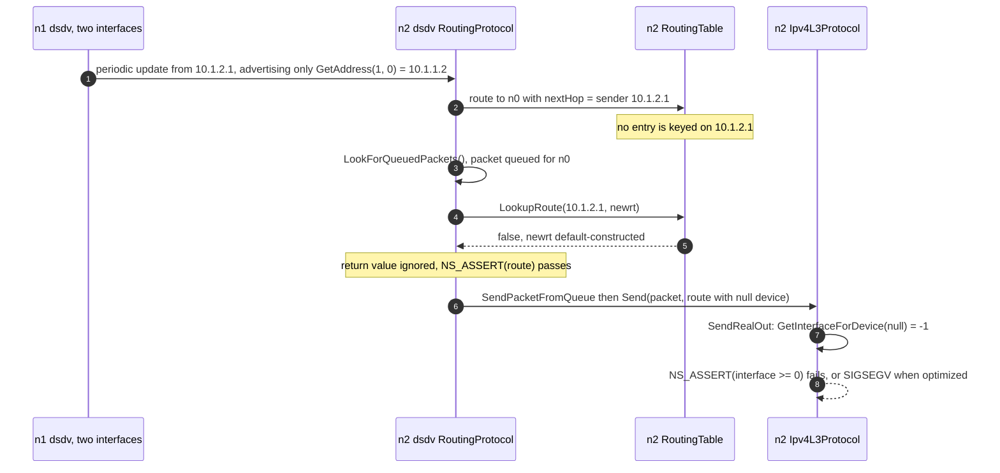
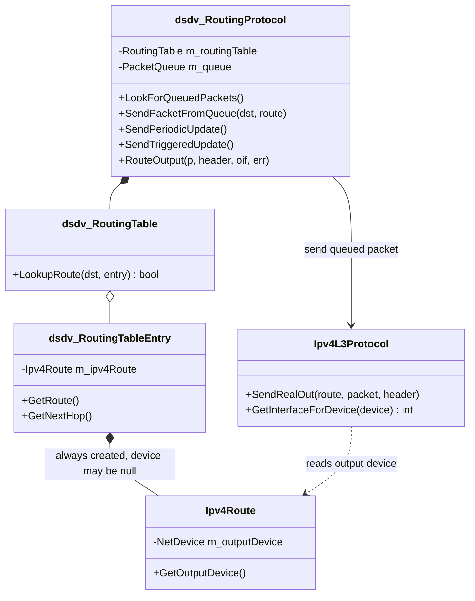

# NS3-003: DSDV sends on a route with a null output device

## Summary

| | |
|---|---|
| ID | NS3-003 |
| RCAPA ticket | [swarm-routing/ns3-tools#240](https://github.com/swarm-routing/ns3-tools/issues/240) |
| Status | reported; fix proposed upstream (merge request open, stalled since 2026-09-16: `need_rebase`, no reviewer; PROC-001); worked around (AntHocNet refuses `dsdv` on multi-interface grids) |
| Found | 2026-08-01 in [swarm-routing/AntHocNet#281](https://github.com/swarm-routing/AntHocNet/issues/281); root cause 2026-08-14 in [swarm-routing/AntHocNet#420](https://github.com/swarm-routing/AntHocNet/issues/420) |
| Last checked | 2026-11-16: [nsnam/ns-3-dev#1364](https://gitlab.com/nsnam/ns-3-dev/-/issues/1364) and [nsnam/ns-3-dev!2985](https://gitlab.com/nsnam/ns-3-dev/-/merge_requests/2985) open, [nsnam/ns-3-dev!2985](https://gitlab.com/nsnam/ns-3-dev/-/merge_requests/2985) `need_rebase` with no reviewer, [nsnam/ns-3-dev!3011](https://gitlab.com/nsnam/ns-3-dev/-/merge_requests/3011) an alternative whose author defers to [nsnam/ns-3-dev!2985](https://gitlab.com/nsnam/ns-3-dev/-/merge_requests/2985) (GitLab API and the MR thread); ns-3.49's `dsdv-routing-protocol.cc` read at its tag, the defect lines unchanged |
| ns-3 versions | run: 3.36, 3.42, 3.48, ns-3-dev `master` `b677fede` (2026-08-15); read: 3.48, 3.49 (same lines); fixed in: none yet |
| Modules | `dsdv` (`RoutingProtocol::LookForQueuedPackets`, the update senders, `RoutingTableEntry`); the fault surfaces in `internet` (`Ipv4L3Protocol::SendRealOut`) |
| Impact on our repositories | stock `dsdv` cannot run on a topology with more than one interface per node (AntHocNet's ISL torus, `isl-grid`): it aborts, or crashes silently in optimized builds. Single-interface runs can hit it rarely (upstream [nsnam/ns-3-dev#503](https://gitlab.com/nsnam/ns-3-dev/-/issues/503): about 0.27 % of 7800 runs). |
| Upstream | [nsnam/ns-3-dev#1364](https://gitlab.com/nsnam/ns-3-dev/-/issues/1364), fix [nsnam/ns-3-dev!2985](https://gitlab.com/nsnam/ns-3-dev/-/merge_requests/2985) |

DSDV's `LookForQueuedPackets()` ignores a failed `LookupRoute()` and sends the
queued packet on a default-constructed route whose output device is null.
`Ipv4L3Protocol::SendRealOut` then asserts `interface >= 0`, or, with asserts
compiled out, indexes with -1 and crashes with empty stderr. DSDV's hard-coded
`GetAddress(1, 0)` advertisement leaves a multi-interface neighbour's other
addresses unadvertised, so a queued packet whose next hop is one of them
fails the lookup: on the tested three-node chain this happens every run.

## Problem and detection

**Symptom.** With asserts on (debug or default profile):
`NS_ASSERT failed, cond="interface >= 0", +15.017072800s 0 file=/opt/ns-3/src/internet/model/ipv4-l3-protocol.cc, line=973`
then SIGABRT (ns-3.42). In an optimized build: a bare SIGSEGV, exit 139,
nothing on stderr.

**How it was detected.** 2026-08-01, the first dispatches of AntHocNet's ISL
corridor cell (6×6 torus) on ns-3.42 images: dsdv crashed at seed 4 after
15 other runs in the process, or at seed 1 when it ran first (CI runs
[30720786720](https://github.com/danieljoppi/AntHocNet/actions/runs/30720786720),
[30721005389](https://github.com/danieljoppi/AntHocNet/actions/runs/30721005389),
[30721151589](https://github.com/danieljoppi/AntHocNet/actions/runs/30721151589);
[swarm-routing/AntHocNet#281](https://github.com/swarm-routing/AntHocNet/issues/281)).
2026-08-14, the same fault on a 4×4 torus and the root cause: DSDV assumes one
non-loopback interface per node
([swarm-routing/AntHocNet#420](https://github.com/swarm-routing/AntHocNet/issues/420)).
2026-08-15, a standalone reproducer with stock modules only, and the
verification against ns-3-dev `master`
([swarm-routing/AntHocNet#434](https://github.com/swarm-routing/AntHocNet/issues/434)).

## Reproduction

The minimal program, stock modules only:
[`dsdv-multi-interface-crash.cc` at AntHocNet `cde1b35b`](https://github.com/swarm-routing/AntHocNet/blob/cde1b35b8155eb763ea240adcfe5a063ffcfe91b/docs/handoffs/ns3-dsdv-upstream/dsdv-multi-interface-crash.cc)
(the repaired copy; the one inlined in swarm-routing/AntHocNet#434's body lost its template arguments
to HTML escaping). A three-node point-to-point chain
`n0 — 10.1.1.0/30 — n1 — 10.1.2.0/30 — n2`, traffic n2 → n0; only n1 has two
interfaces.

```bash
# in an ns-3 tree with asserts on, e.g. ghcr.io/swarm-routing/ns3-dev:3.48-debug,
# the program copied to scratch/
./ns3 run "dsdv-multi-interface-crash"                   # chain of 3
./ns3 run "dsdv-multi-interface-crash --csma=1"          # the same over CSMA
./ns3 run "dsdv-multi-interface-crash --nNodes=2"        # control: no multi-interface node
./ns3 run "dsdv-multi-interface-crash --protocol=aodv"   # control: also olsr, rip
```

| Run | Expected | Actual (3.36, 3.48, ns-3-dev `b677fede`) |
|---|---|---|
| dsdv, 3 nodes | completes and delivers | `NS_ASSERT failed, cond="interface >= 0"` at `+1.512000000s` (`ipv4-l3-protocol.cc:937` in 3.48, `:960` in ns-3-dev); optimized: exit 139, 0 bytes on stderr |
| dsdv, `--csma=1` | completes | the same assert |
| dsdv, `--nNodes=2` | completes | completes |
| aodv / olsr / rip, 3 nodes | completes | completes and delivers (9728 B with aodv and rip) |

- No randomness: the fault is deterministic on the chain.
- Images: `ghcr.io/swarm-routing/ns3-dev:3.48-debug`
  (`sha256:d81ec51cd842c1fcae85f82c55973615cdde4c7a477c831897d62a6fdb62c2c2` on
  2026-11-16). Not yet re-run on `latest` (3.49): an acceptance box of swarm-routing/ns3-tools#240.
- The single-interface stress program from the same handoff,
  [`dsdv-single-interface-stress.cc`](https://github.com/swarm-routing/AntHocNet/blob/cde1b35b8155eb763ea240adcfe5a063ffcfe91b/docs/handoffs/ns3-dsdv-upstream/dsdv-single-interface-stress.cc),
  tries the rare single-interface path (upstream [nsnam/ns-3-dev#503](https://gitlab.com/nsnam/ns-3-dev/-/issues/503)).

## Root cause: five whys

1. **Why does `SendRealOut` assert?** The route it is given has a null output
   device, so `GetInterfaceForDevice(outDev)` returns -1 and
   `NS_ASSERT(interface >= 0)` fails (`src/internet/model/ipv4-l3-protocol.cc:958–960`,
   ns-3.49; `:937` in 3.48). The `if (!route)` guard above it
   (`:952`) does not help: the route object exists.
2. **Why is there a route object with no device?** `LookForQueuedPackets()`
   calls `m_routingTable.LookupRoute(rt.GetNextHop(), newrt)` and ignores the
   result (`src/dsdv/model/dsdv-routing-protocol.cc:1161`, ns-3.48 and
   ns-3.49), then sends on `newrt.GetRoute()`. A default-constructed
   `RoutingTableEntry` always allocates its `Ipv4Route`
   (`dsdv-rtable.cc:50`, `m_ipv4Route = Create<Ipv4Route>();`) with no output
   device, so `NS_ASSERT(route)` at `:1163` can never fire. `RouteOutput`
   checks the same lookup (`:330`); this path does not.
3. **Why does the next-hop lookup fail?** The next hop is learned from the
   update's source address (`nextHop = sender`, `dsdv-routing-protocol.cc:619`),
   but a node advertises itself only as `m_ipv4->GetAddress(1, 0)`
   (`:861–862`, `:913`, `:916`). n1 hears as 10.1.2.1 on one link but announces
   only 10.1.1.2, so n2 has no table entry keyed on its own next hop (swarm-routing/AntHocNet#434 §1
   and the reproducer's header comment).
4. **Why does DSDV advertise one hard-coded address?** It was written for one
   non-loopback interface per node, since the original contribution (about
   ns-3.9, 2010); nothing documents that limit, and the same file's
   `LoopbackRoute()` already handles several interfaces (swarm-routing/AntHocNet#434 §2, §3).
5. **Why did nobody catch it upstream?** Upstream [nsnam/ns-3-dev#503](https://gitlab.com/nsnam/ns-3-dev/-/issues/503) (2021) carried the same
   frames on single-interface Wi-Fi and was closed in 2025 assuming a fix; MR
   [nsnam/ns-3-dev!1652](https://gitlab.com/nsnam/ns-3-dev/-/merge_requests/1652) (2023) moved the `NS_ASSERT(route)` that cannot fire and left the
   unchecked lookup (swarm-routing/AntHocNet#434 §2). Our own per-PR satellite gates used a 1×2
   anchor, one interface per node, which does not exercise the deterministic
   multi-interface trigger (swarm-routing/AntHocNet#434 §5); whether the rare single-interface crash
   of [nsnam/ns-3-dev#503](https://gitlab.com/nsnam/ns-3-dev/-/issues/503) is the same path is likely but not proven.

**Root cause.** An unchecked routing-table lookup in
`LookForQueuedPackets()` turns a missing next hop into a send on a device-less
route; the single-address advertisement makes the missing next hop certain on
multi-interface nodes.

## Diagrams

### Failing call chain



### ns-3 types involved



## Source excerpts

`src/dsdv/model/dsdv-routing-protocol.cc:1158–1168`, ns-3.49 (identical in
ns-3.48):

```cpp
            else
            {
                RoutingTableEntry newrt;
                m_routingTable.LookupRoute(rt.GetNextHop(), newrt);
                route = newrt.GetRoute();
                NS_ASSERT(route);
                NS_LOG_LOGIC("A route exists from " << route->GetSource() << " to destination "
                                                    << route->GetDestination() << " via "
                                                    << rt.GetNextHop());
            }
            SendPacketFromQueue(rt.GetDestination(), route);
```

`src/dsdv/model/dsdv-routing-protocol.cc:860–862`, ns-3.49:

```cpp
            RoutingTableEntry temp2;
            m_routingTable.LookupRoute(m_ipv4->GetAddress(1, 0).GetBroadcast(), temp2);
            dsdvHeader.SetDst(m_ipv4->GetAddress(1, 0).GetLocal());
```

`src/internet/model/ipv4-l3-protocol.cc:952–960`, ns-3.49:

```cpp
    if (!route)
    {
        NS_LOG_WARN("No route to host.  Drop.");
        m_dropTrace(ipHeader, packet, DROP_NO_ROUTE, this, 0);
        return;
    }
    Ptr<NetDevice> outDev = route->GetOutputDevice();
    int32_t interface = GetInterfaceForDevice(outDev);
    NS_ASSERT(interface >= 0);
```

## Corrective actions (ours)

| Action | Where | Status |
|--------|-------|--------|
| The corridor cell's protocol list drops `dsdv` | [swarm-routing/AntHocNet#281](https://github.com/swarm-routing/AntHocNet/issues/281) | done |
| `isl-grid` refuses `dsdv` up front on any topology where a node holds more than one ISL ("ns-3's DSDV is single-interface-only (swarm-routing/AntHocNet#420)") | swarm-routing/AntHocNet `ns3/anthocnet/examples/isl-grid.cc` ([swarm-routing/AntHocNet#422](https://github.com/swarm-routing/AntHocNet/pull/422)) | done |
| ns3-tools: `routing-compare`'s own scenarios give each node one Wi-Fi interface, so the deterministic trigger is not reached; no guard here | — | none needed today |

## Preventive actions

| Action | Where | Status |
|--------|-------|--------|
| Satellite protocol-arm smoke: every arm runs on a 3×3 torus, and `dsdv` is refused rather than crashing | swarm-routing/AntHocNet `ci-ns3.yml` (swarm-routing/AntHocNet#422) | done |
| The same audit turned on our vendored arms: GPSR's hard-coded device, AOMDV's unchecked `PathFind()` | [swarm-routing/AntHocNet#437](https://github.com/swarm-routing/AntHocNet/issues/437), [swarm-routing/AntHocNet#416](https://github.com/swarm-routing/AntHocNet/issues/416) | tracked there |
| Re-run the reproducer on `latest` and on ns-3-dev `master`; on the release that carries [nsnam/ns-3-dev!2985](https://gitlab.com/nsnam/ns-3-dev/-/merge_requests/2985), re-run it and revisit the `isl-grid` guard | [swarm-routing/ns3-tools#240](https://github.com/swarm-routing/ns3-tools/issues/240) | open |

## Upstream report

**Status: reported by the maintainer on 2026-08-16; fix proposed.**

- Issue [nsnam/ns-3-dev#1364](https://gitlab.com/nsnam/ns-3-dev/-/issues/1364):
  "dsdv: LookForQueuedPackets() ignores a failed LookupRoute() and sends on a
  route with a null output device (assert in default, silent SIGSEGV in
  optimized)", open on 2026-11-16.
- Merge request [nsnam/ns-3-dev!2985](https://gitlab.com/nsnam/ns-3-dev/-/merge_requests/2985),
  open on 2026-11-16 (last updated 2026-09-16), commits (as recorded on
  2026-08-17): `09f6e4d1` do not send queued packets when the next-hop lookup
  fails; `9e7d4b1d` advertise the address of the interface a message is sent
  from; `32420b67` invoke the error callback when dropping queued packets;
  `34524842` a regression test for a multi-interface chain.
- A pointer comment on the older [nsnam/ns-3-dev#503](https://gitlab.com/nsnam/ns-3-dev/-/issues/503).

Nothing is left to file, but the merge request is not merged. Its thread
after 2026-08-17, unread here until 2026-11-16:

- 2026-09-13, [note 3825700321](https://gitlab.com/nsnam/ns-3-dev/-/merge_requests/2985#note_3825700321):
  an alternative fix, [nsnam/ns-3-dev!3011](https://gitlab.com/nsnam/ns-3-dev/-/merge_requests/3011), announced.
- 2026-09-16: [nsnam/ns-3-dev!3011](https://gitlab.com/nsnam/ns-3-dev/-/merge_requests/3011)'s author: "This MR also fixes the root advertisement bug
  and asserts real delivery, so I think closing off [nsnam/ns-3-dev!3011](https://gitlab.com/nsnam/ns-3-dev/-/merge_requests/3011) could be the right
  call here."
- Since then: `detailed_merge_status` `need_rebase`, no reviewer assigned,
  head pipeline green.

Next (maintainer, swarm-routing/.github#519 section 4): rebase on `master`
and request a `module::dsdv` review, citing [nsnam/ns-3-dev!3011](https://gitlab.com/nsnam/ns-3-dev/-/merge_requests/3011)'s deferral. How this went
unnoticed, and what prevents it, is PROC-001
([`ns3-rcapa-upstream-report-tracking.md`](ns3-rcapa-upstream-report-tracking.md), swarm-routing/ns3-tools#247).

## Timeline

| Date | Event |
|------|-------|
| 2021-12-08 | upstream [nsnam/ns-3-dev#503](https://gitlab.com/nsnam/ns-3-dev/-/issues/503) reports the same frames on single-interface Wi-Fi (closed 2025-06-09 without a fix) |
| 2026-08-01 | swarm-routing/AntHocNet#281: dsdv crashes the ISL corridor cell |
| 2026-08-14 | swarm-routing/AntHocNet#420 root cause; swarm-routing/AntHocNet#422 merged (guard and arm smoke) |
| 2026-08-15 | swarm-routing/AntHocNet#434: reproducer, verification on ns-3-dev `master` `b677fede`, draft |
| 2026-08-16 | filed as [nsnam/ns-3-dev#1364](https://gitlab.com/nsnam/ns-3-dev/-/issues/1364) with MR [nsnam/ns-3-dev!2985](https://gitlab.com/nsnam/ns-3-dev/-/merge_requests/2985); the upstream maintainer asks for multi-interface compliance, the MR grows the advertisement fix |
| 2026-08-17 | filing record verified against GitLab (swarm-routing/AntHocNet#445, swarm-routing/AntHocNet#452) |
| 2026-09-13 | alternative fix [nsnam/ns-3-dev!3011](https://gitlab.com/nsnam/ns-3-dev/-/merge_requests/3011) announced on [nsnam/ns-3-dev!2985](https://gitlab.com/nsnam/ns-3-dev/-/merge_requests/2985) (note 3825700321) |
| 2026-09-16 | [nsnam/ns-3-dev!3011](https://gitlab.com/nsnam/ns-3-dev/-/merge_requests/3011)'s author proposes closing it in favour of [nsnam/ns-3-dev!2985](https://gitlab.com/nsnam/ns-3-dev/-/merge_requests/2985); no activity on [nsnam/ns-3-dev!2985](https://gitlab.com/nsnam/ns-3-dev/-/merge_requests/2985) since |
| 2026-11-16 | registered as NS3-003, RCAPA ticket swarm-routing/ns3-tools#240; [nsnam/ns-3-dev#1364](https://gitlab.com/nsnam/ns-3-dev/-/issues/1364) and [nsnam/ns-3-dev!2985](https://gitlab.com/nsnam/ns-3-dev/-/merge_requests/2985) still open, no release carries the fix (ns-3.49 is the latest); [nsnam/ns-3-dev!2985](https://gitlab.com/nsnam/ns-3-dev/-/merge_requests/2985) found stalled (`need_rebase`, no reviewer), recorded as PROC-001 (swarm-routing/ns3-tools#247) |

## Links

- Investigation: [swarm-routing/AntHocNet#281](https://github.com/swarm-routing/AntHocNet/issues/281), [swarm-routing/AntHocNet#420](https://github.com/swarm-routing/AntHocNet/issues/420), [swarm-routing/AntHocNet#434](https://github.com/swarm-routing/AntHocNet/issues/434) (the [archived handoff](https://github.com/swarm-routing/AntHocNet/issues/434#issuecomment-6267904034), the [reconciliation](https://github.com/swarm-routing/AntHocNet/issues/434#issuecomment-5310630314))
- Record: [swarm-routing/AntHocNet#445](https://github.com/swarm-routing/AntHocNet/pull/445), [swarm-routing/AntHocNet#452](https://github.com/swarm-routing/AntHocNet/pull/452); the handoff files at [`cde1b35b`](https://github.com/swarm-routing/AntHocNet/tree/cde1b35b8155eb763ea240adcfe5a063ffcfe91b/docs/handoffs/ns3-dsdv-upstream) (reproducers and both patches)
- Workaround: [swarm-routing/AntHocNet#422](https://github.com/swarm-routing/AntHocNet/pull/422)
- Upstream: [nsnam/ns-3-dev#1364](https://gitlab.com/nsnam/ns-3-dev/-/issues/1364), [nsnam/ns-3-dev!2985](https://gitlab.com/nsnam/ns-3-dev/-/merge_requests/2985), [nsnam/ns-3-dev#503](https://gitlab.com/nsnam/ns-3-dev/-/issues/503)
- ns-3 sources (ns-3.49 tag): [`dsdv-routing-protocol.cc`](https://gitlab.com/nsnam/ns-3-dev/-/blob/ns-3.49/src/dsdv/model/dsdv-routing-protocol.cc), [`dsdv-rtable.cc`](https://gitlab.com/nsnam/ns-3-dev/-/blob/ns-3.49/src/dsdv/model/dsdv-rtable.cc), [`ipv4-l3-protocol.cc`](https://gitlab.com/nsnam/ns-3-dev/-/blob/ns-3.49/src/internet/model/ipv4-l3-protocol.cc)
- RCAPA ticket: [swarm-routing/ns3-tools#240](https://github.com/swarm-routing/ns3-tools/issues/240)
