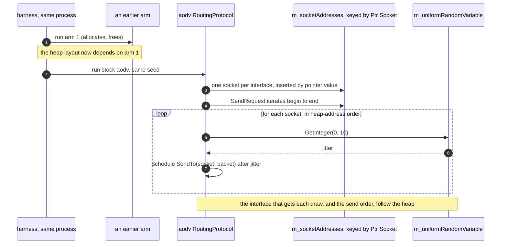
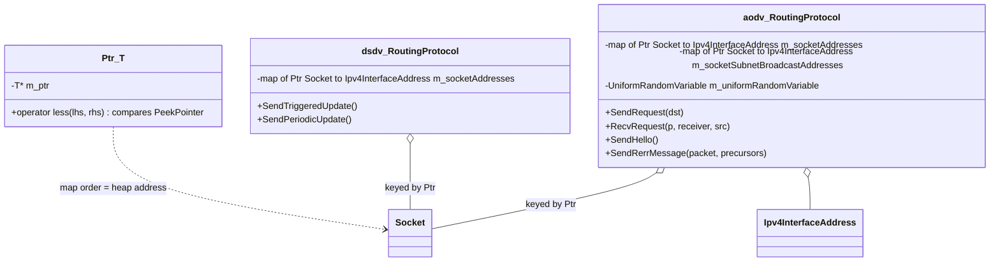
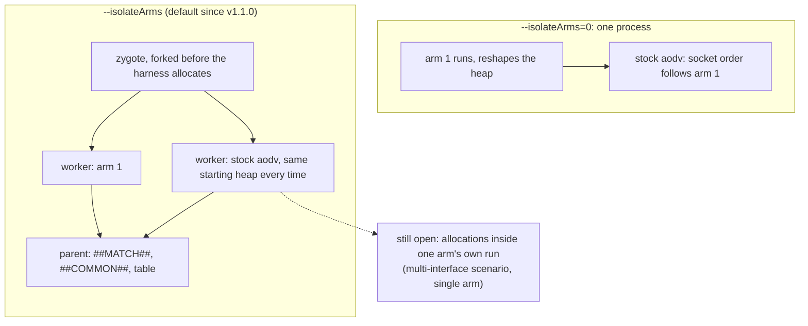

# NS3-002: AODV and DSDV order per-interface sockets by heap address

## Summary

| | |
|---|---|
| ID | NS3-002 |
| RCAPA ticket | [#239](https://github.com/swarm-routing/ns3-tools/issues/239) |
| Status | open upstream; draft ready, not yet reported; worked around (`--isolateArms`) |
| Found | 2026-08-05 in [swarm-routing/AntHocNet#362](https://github.com/swarm-routing/AntHocNet/issues/362); cause shown 2026-11-15 in [#198](https://github.com/swarm-routing/ns3-tools/issues/198) |
| Last checked | 2026-11-16: the declarations and loops below read at the ns-3.48 and ns-3.49 tags for this page |
| ns-3 versions | run: 3.42 (#362's CI), 3.48 (swarm-routing/AntHocNet#1039), 3.49 (#198, #212); read: 3.42, 3.48, 3.49; earlier releases not checked |
| Modules | `aodv` (`RoutingProtocol::m_socketAddresses`, `m_socketSubnetBroadcastAddresses`), `dsdv` (`RoutingProtocol::m_socketAddresses`); `core` (`Ptr<T>::operator<`) |
| Impact on our repositories | any scenario with more than one interface per node (AntHocNet's `isl-grid` and `leo-walker`, routing-bench test arms) gives stock AODV and DSDV rows that move with unrelated allocations: byte-identity checks and attribution controls fail on them. Single-interface Wi-Fi scenarios (routing-compare's own) are unaffected. No published conclusion changed: the paired deltas stayed within noise (swarm-routing/AntHocNet#675). |
| Upstream | not yet reported; text in [#206](https://github.com/swarm-routing/ns3-tools/issues/206) |

Stock AODV and DSDV keep one socket per interface in a `std::map` keyed by
`Ptr<Socket>`, which orders by raw pointer, so the maps iterate in heap-address
order. AODV draws one random jitter per socket inside that loop. With several
interfaces per node, which interface gets which draw depends on where the
allocator put each socket, so the same seed gives a different result when
anything earlier in the process allocated differently (org golden rule 5).

## Problem and detection

**Symptom.** Same seed, same binary, different `##RUN##` rows for stock AODV,
depending only on what ran or allocated before it in the process.

**How it was detected.**

1. 2026-08-05, AntHocNet's seed-independence gate, `isl-grid` order case (CI
   run [31042695598](https://github.com/danieljoppi/AntHocNet/actions/runs/31042695598/job/92430653738),
   ns-3.42): `--protocols=anthocnet,aodv` and `--protocols=aodv,anthocnet`
   differ in 7 of 8 rows; AODV's seed 2 `delay99` goes 11 → 24 ms
   ([swarm-routing/AntHocNet#362](https://github.com/swarm-routing/AntHocNet/issues/362)).
2. 2026-10-16, v2.2.0 re-baseline: every row reproduced byte for byte except
   stock AODV on the satellite cells; the first shift bisected to a commit that
   touches neither AODV nor the harness
   ([swarm-routing/AntHocNet#675](https://github.com/swarm-routing/AntHocNet/issues/675)).
3. 2026-11-15, AntHocNet's `leo-walker` gate (`ns3-dev:3.48`,
   `sha256:36663efd…`): a function-local static added to the `anthocnet` arm
   moved the `aodv` arm's row, run later in the same process, from
   `##RUN## 1 aodv 60.26 105.14 849.00 6.70 140.51 74.58 12.73` to
   `56.73 103.35 870.00 6.31 138.29 73.04 13.33`
   ([swarm-routing/AntHocNet#1039](https://github.com/swarm-routing/AntHocNet/issues/1039)).
4. 2026-11-15, the cause shown in a scratch container: stock AODV on a 3×3
   point-to-point torus, 3000 dummy allocations moved `delaySum`
   3.7024096 → 4.3779808 and `l3tx` 2432 → 2431; with the maps ordered by
   interface index every churn level gave the identical row
   ([#198](https://github.com/swarm-routing/ns3-tools/issues/198#issuecomment-6896069314)).

## Reproduction

This repository's test suite carries the case. `aodv-spare-if` is stock AODV
with a second, idle interface on every node; `heap-churn` is stock AODV that
reshapes the heap (6000 blocks, two in three freed)
(`ns3/routing-bench/test/routing-bench-test-suite.cc`).

```bash
docker run --rm -v "$PWD:/src:ro" ghcr.io/swarm-routing/ns3-dev:latest-debug \
    ns3-build-contrib --test routing-bench=/src/ns3/routing-bench
```

- Expected (deterministic ns-3): `ArmIsolationTest` reports
  `isolateArms=0: aodv-spare-if after heap-churn matches its rows alone (#198)`.
- Actual (stock ns-3.49, glibc allocator): `... DIFFERS from its rows alone (#198)`.
  The test reports this half and does not assert it; under ASan (the sanitized
  image) freed blocks are not reused soon, so it may print `matches`.
- Image: `ghcr.io/swarm-routing/ns3-dev:latest-debug` = `3.49-debug`
  (`sha256:dc9d3e01e3c9c90060fc2f97f576446ff9affcbd5b240193cab7deeefffc1dd6`
  on 2026-11-16).
- Seeds: the suite's own command lines. The same command line from different
  starting heaps (churn 0, 50, 500, 5000 allocations) gave three different run-2
  rows, e.g. `##RUN## 2 aodv-spare-if 53.3 5.0 11.5 …` against
  `53.3 2.7 4.5 …` ([#212](https://github.com/swarm-routing/ns3-tools/pull/212)).
- Minimal program: the test arms above, at
  [`routing-bench-test-suite.cc` at `bb2951e`](https://github.com/swarm-routing/ns3-tools/blob/bb2951e1d25eee3e5d5260927f6288a443fa4ee8/ns3/routing-bench/test/routing-bench-test-suite.cc).
  No standalone ns-3 program is committed yet; the upstream text in #206
  describes one (3×3 point-to-point torus, stock AODV, UDP traffic, a few
  thousand allocations kept alive before a second `Simulator::Run()`).

## Root cause: five whys

1. **Why does the same seed give different AODV rows?** Which interface sends
   first, and with which random jitter, changes between runs. Ordering the maps
   by interface index made every churn level give the identical row (#198), so
   the order of the per-interface loop is what varies.
2. **Why does the loop order vary?** AODV and DSDV iterate
   `std::map<Ptr<Socket>, Ipv4InterfaceAddress>`
   (`src/aodv/model/aodv-routing-protocol.h:256`, `:259`;
   `src/dsdv/model/dsdv-routing-protocol.h:151`; ns-3.48 and ns-3.49), and a
   `std::map` iterates in key order.
3. **Why is the key order arbitrary?** `Ptr<T>`'s `operator<` compares the raw
   pointers: `return PeekPointer<T>(lhs) < PeekPointer<T>(rhs);`
   (`src/core/model/ptr.h:580–583`, ns-3.49). The order is the order of the
   sockets' heap addresses, which follows every allocation and free made
   before the sockets were created, in any code in the process.
4. **Why does the order reach the results?** AODV draws
   `m_uniformRandomVariable->GetInteger(0, 10)` once per socket inside the
   loop, when it sends a RREQ (`SendRequest`, `aodv-routing-protocol.cc:1123`,
   `:1150`), forwards one (`RecvRequest`, `:1490`, `:1512`), sends a hello
   (`SendHello`, `:1984`, `:2011`) and RERRs (`SendRerrWhenNoRouteToForward`,
   `:2129`; `SendRerrMessage`, `:2182`, `:2223`); ns-3.49. So the order decides
   which interface gets which draw, and the order of the sends. DSDV iterates
   its map for every triggered and periodic update
   (`dsdv-routing-protocol.cc:820` `SendTriggeredUpdate`, `:902`
   `SendPeriodicUpdate`).
5. **Why did our checks not see it for months?** With one interface per node
   each map holds one entry and the order cannot vary, so every single-interface
   harness passed (#362: `anthocnet-compare` passed, `isl-grid` failed). And a
   "run it twice" determinism gate allocates identically both times; only a
   change in *preceding* work (another arm, another protocol order, a static
   in unrelated code) exposes it (#362 "Why the existing gates did not catch
   it").

**Root cause.** A container keyed by pointer value orders by heap address;
stock AODV and DSDV use one as the per-interface iteration order and consume
random draws in that order.

## Diagrams

### Failing call chain



### ns-3 types involved



### Harness processes: what `--isolateArms` changes



## Source excerpts

`src/aodv/model/aodv-routing-protocol.h:255–259`, ns-3.49 (same lines in
ns-3.48):

```cpp
    /// Raw unicast socket per each IP interface, map socket -> iface address (IP + mask)
    std::map<Ptr<Socket>, Ipv4InterfaceAddress> m_socketAddresses;
    /// Raw subnet directed broadcast socket per each IP interface, map socket -> iface address (IP
    /// + mask)
    std::map<Ptr<Socket>, Ipv4InterfaceAddress> m_socketSubnetBroadcastAddresses;
```

`src/core/model/ptr.h:579–583`, ns-3.49:

```cpp
bool
operator<(const Ptr<T>& lhs, const Ptr<T>& rhs)
{
    return PeekPointer<T>(lhs) < PeekPointer<T>(rhs);
}
```

`src/aodv/model/aodv-routing-protocol.cc:1122–1155`, ns-3.49 (`SendRequest`,
shortened):

```cpp
    // Send RREQ as subnet directed broadcast from each interface used by aodv
    for (auto j = m_socketAddresses.begin(); j != m_socketAddresses.end(); ++j)
    {
        Ptr<Socket> socket = j->first;
        Ipv4InterfaceAddress iface = j->second;
        ...
        Simulator::Schedule(MilliSeconds(m_uniformRandomVariable->GetInteger(0, 10)),
                            &RoutingProtocol::SendTo,
                            this,
                            socket,
                            packet,
                            destination);
    }
```

## Corrective actions (ours)

The code is stock ns-3: we do not patch it (org golden rule 2; the
`ns3-dev` images stay stock).

| Action | Where | Status |
|--------|-------|--------|
| Each arm in its own worker process, forked from one zygote, by default (`--isolateArms`) | ns3-tools [#202](https://github.com/swarm-routing/ns3-tools/pull/202), v1.1.0; `ns3/routing-bench/README.md` "Each arm in its own process" | done |
| The isolation test forks every run from one prepared state | ns3-tools [#212](https://github.com/swarm-routing/ns3-tools/pull/212), v1.1.1 | done |
| AntHocNet's own adapter orders its maps by the bound device's interface index | [swarm-routing/AntHocNet#471](https://github.com/swarm-routing/AntHocNet/pull/471) | done |
| The `leo-walker` gate runs the stock `aodv` arm in its own process | [swarm-routing/AntHocNet#1059](https://github.com/swarm-routing/AntHocNet/pull/1059) | done |
| The `isl-grid` order case compares the `anthocnet` rows only ("aodv is upstream ns-3 and still pointer-keyed"); methodology's threat-to-validity note | swarm-routing/AntHocNet `tools/checks/check-seed-independence.py`, `docs/benchmarks/methodology.md` | done |

## Preventive actions

| Action | Where | Status |
|--------|-------|--------|
| `ArmIsolationTest`: every stock arm and `aodv-spare-if` alone vs after `heap-churn` and other arms must be identical when isolated; the stock single-process behaviour is reported | ns3-tools `routing-bench-test-suite.cc` (#202, #212) | done |
| The suite also runs through the bare test runner, with a second arm module installed | ns3-tools `.github/workflows/ns3.yml` ([#214](https://github.com/swarm-routing/ns3-tools/pull/214), #212) | done |
| AntHocNet's seed-independence gate (order case for `isl-grid`) | swarm-routing/AntHocNet `tools/checks/check-seed-independence.py` (#471) | done |
| On a fixed ns-3 release: a multi-interface, single-process (`--isolateArms=0`) heap-churn case that must pass for `aodv` and `dsdv` | [#206](https://github.com/swarm-routing/ns3-tools/issues/206), [#239](https://github.com/swarm-routing/ns3-tools/issues/239) | open (needs the upstream fix) |

## Upstream report

**Status: draft ready, not yet reported.** The ready-to-file text (title,
modules and versions, description, how to reproduce, expected, proposed fix)
is kept in [#206](https://github.com/swarm-routing/ns3-tools/issues/206),
"Ready-to-file upstream bug text"; edits are made there. The maintainer files
it on the nsnam GitLab under their own account; the link then goes into #206,
#239 and the register. Before filing, re-run the #206 reproducer on ns-3-dev
`master` and record the commit on #239.

Proposed fix (from #206): key the maps by interface index, for example
`std::map<uint32_t, std::pair<Ptr<Socket>, Ipv4InterfaceAddress>>`, so
iteration follows interface order; the send loops keep their bodies and the
lookups by socket or address become lookups by interface index.

## Timeline

| Date | Event |
|------|-------|
| 2026-08-05 | swarm-routing/AntHocNet#362: `isl-grid` rows depend on `--protocols` order |
| 2026-09-24 | swarm-routing/AntHocNet#471 merged: AntHocNet's own maps ordered by interface; the order case gates `anthocnet` only |
| 2026-10-16 | swarm-routing/AntHocNet#675: stock AODV satellite rows move with unrelated code (v2.2.0 re-baseline) |
| 2026-11-15 | swarm-routing/AntHocNet#1039 (the `leo-walker` gate), #198 (cause shown), #202 merged (`--isolateArms`, v1.1.0), #206 opened with the upstream text, swarm-routing/AntHocNet#1059 merged; #211/#212 (the test's own heap, v1.1.1) |
| 2026-11-16 | registered as NS3-002, RCAPA ticket #239 |

## Links

- Investigation: [swarm-routing/AntHocNet#362](https://github.com/swarm-routing/AntHocNet/issues/362), [swarm-routing/AntHocNet#675](https://github.com/swarm-routing/AntHocNet/issues/675), [swarm-routing/AntHocNet#1039](https://github.com/swarm-routing/AntHocNet/issues/1039), [#198](https://github.com/swarm-routing/ns3-tools/issues/198), [#211](https://github.com/swarm-routing/ns3-tools/issues/211)
- Fixes on our side: [swarm-routing/AntHocNet#471](https://github.com/swarm-routing/AntHocNet/pull/471), [swarm-routing/AntHocNet#1040](https://github.com/swarm-routing/AntHocNet/pull/1040) (hid it), [swarm-routing/AntHocNet#1059](https://github.com/swarm-routing/AntHocNet/pull/1059), [#202](https://github.com/swarm-routing/ns3-tools/pull/202), [#212](https://github.com/swarm-routing/ns3-tools/pull/212), [#214](https://github.com/swarm-routing/ns3-tools/pull/214)
- Upstream text: [#206](https://github.com/swarm-routing/ns3-tools/issues/206); RCAPA ticket: [#239](https://github.com/swarm-routing/ns3-tools/issues/239)
- ns-3 sources (ns-3.49 tag): [`aodv-routing-protocol.h`](https://gitlab.com/nsnam/ns-3-dev/-/blob/ns-3.49/src/aodv/model/aodv-routing-protocol.h), [`aodv-routing-protocol.cc`](https://gitlab.com/nsnam/ns-3-dev/-/blob/ns-3.49/src/aodv/model/aodv-routing-protocol.cc), [`dsdv-routing-protocol.h`](https://gitlab.com/nsnam/ns-3-dev/-/blob/ns-3.49/src/dsdv/model/dsdv-routing-protocol.h), [`dsdv-routing-protocol.cc`](https://gitlab.com/nsnam/ns-3-dev/-/blob/ns-3.49/src/dsdv/model/dsdv-routing-protocol.cc), [`ptr.h`](https://gitlab.com/nsnam/ns-3-dev/-/blob/ns-3.49/src/core/model/ptr.h)
