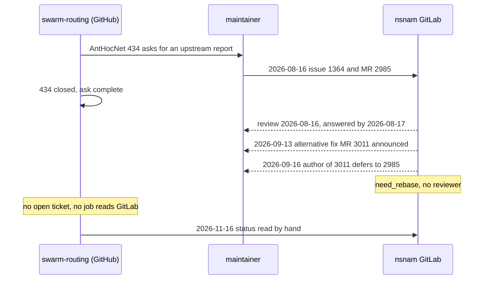
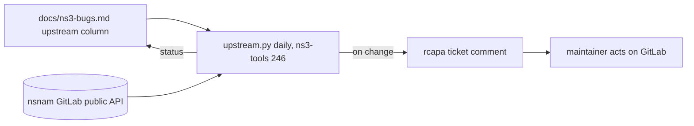

# PROC-001: upstream reports have no owner after filing

## Summary

| | |
|---|---|
| ID | PROC-001 (a defect in how we carry ns-3 reports, not in ns-3) |
| RCAPA ticket | [#247](https://github.com/swarm-routing/ns3-tools/issues/247): `[rcapa] PROC-001 upstream reports have no owner after filing` |
| Status | open; corrective action with the maintainer, preventive action planned ([#246](https://github.com/swarm-routing/ns3-tools/issues/246)) |
| Found | 2026-11-16, while recording NS3-003's upstream status ([#240 comment](https://github.com/swarm-routing/ns3-tools/issues/240#issuecomment-6917110568)) |
| Last checked | 2026-11-16: the upstream thread of !2985 and #1364, read from GitLab's public endpoints |
| Affects | every upstream report: NS3-003 today; NS3-001 and NS3-002 once filed ([swarm-routing/.github#519](https://github.com/swarm-routing/.github/issues/519)) |
| Impact on our repositories | NS3-003's fix has waited two months for actions only we could take. Until it ships, AntHocNet's `isl-grid` keeps refusing `dsdv` on multi-interface topologies, so the satellite families compare one stock arm fewer |

We filed NS3-003 upstream with a fix on 2026-08-16 and answered every review
point by 2026-08-17. After that, nothing here watched the merge request. On
2026-09-13 an alternative fix appeared, and on 2026-09-16 its author deferred
to ours. Since then the merge request has needed a rebase and has had no
reviewer. Nobody noticed for two months.

## Problem and detection

The fix for NS3-003 is
[!2985](https://gitlab.com/nsnam/ns-3-dev/-/merge_requests/2985), for
[#1364](https://gitlab.com/nsnam/ns-3-dev/-/work_items/1364). Its state, read
on 2026-11-16:

| Item | State | Last activity |
|---|---|---|
| issue #1364 | open | 2026-09-13 |
| MR !2985 (ours) | open, not a draft, `module::dsdv`, head pipeline **success**, `detailed_merge_status` **`need_rebase`**, **no reviewers** | 2026-09-16 |
| MR [!3011](https://gitlab.com/nsnam/ns-3-dev/-/merge_requests/3011) (an alternative fix by another contributor) | open | 2026-10-15 |

The thread's last two notes nobody here had read:

- 2026-09-13, [note 3825700321](https://gitlab.com/nsnam/ns-3-dev/-/merge_requests/2985#note_3825700321):
  "Srajan Gupta proposed an alternative fix in !3011".
- 2026-09-16: "This MR also fixes the root advertisement bug and asserts real
  delivery, so I think closing off !3011 could be the right call here."

It was found by hand on 2026-11-16, when the maintainer pointed at the first of
those notes while the register's NS3-003 row was being recorded.

## Root cause: five whys

1. **Why did !2985 stall unnoticed?** Nobody here read its thread after
   2026-08-17. The last record of it is
   [swarm-routing/AntHocNet#434](https://github.com/swarm-routing/AntHocNet/issues/434)'s
   reconciliation comment of 2026-08-17. GitLab notifies only the account that
   filed, so the org learned nothing of the 2026-09-13 and 2026-09-16 notes.
2. **Why did nobody read it?** No open ticket owned the report after it was
   filed. #434's scope was "report the crash to nsnam", and it closed on
   2026-08-16 with the comment "Filed upstream — this issue's ask is complete".
   The other tickets (AntHocNet#281, #420) closed with the workaround
   (AntHocNet#422), which made our runs safe without the upstream fix.
3. **Why did closing on filing look right?** Neither the issue taxonomy nor
   AntHocNet ADR-0013 says that an upstream report's ticket stays open until
   the fix ships. A finding with a working workaround reads as done.
4. **Why did no automation catch it?** Every org pipeline reads GitHub only:
   org-bot, release-sync, zenodo, pr-status. Nothing reads gitlab.com, so a
   stalled merge request, a competing one or an unanswered note is invisible to
   the record.
5. **Why has that gap survived?** Before 2026-11-16 there was no single list of
   our upstream reports to watch. NS3-003's history is spread over five
   AntHocNet issues and PRs, and the register (#235) with its RCAPA ticket rule
   only arrived that day. With one report, watching it was left to memory.

## Diagrams

### What happened

### What the preventive action adds

## Corrective actions

| Action | Where | Status |
|--------|-------|--------|
| Record !2985's state, the competing !3011 and the stall on NS3-003's record | [#240](https://github.com/swarm-routing/ns3-tools/issues/240), this register | done 2026-11-16 |
| Rebase !2985 on `master` and request a `module::dsdv` review, citing !3011's deferral | [swarm-routing/.github#519](https://github.com/swarm-routing/.github/issues/519) section 4 (maintainer only) | open |

## Preventive actions

| Action | Where | Status |
|--------|-------|--------|
| A daily pipeline reads every upstream link in the register from GitLab and comments on the RCAPA ticket when anything changes (new notes, `need_rebase`, no reviewer, competing MRs, no activity for 14 days) | [#246](https://github.com/swarm-routing/ns3-tools/issues/246) | open |
| An RCAPA ticket stays open until the fix is in an ns-3 release we run; filing is a step, not the end | [README "Adding a bug"](README.md#adding-a-bug-the-ticket-first); swarm-routing/.github CONTRIBUTING "ns-3 bugs (RCAPA)" (#247) | README done; CONTRIBUTING open |
| Every upstream report is a row in the register with its RCAPA ticket, so the tracker has one list to read | [`../ns3-bugs.md`](../ns3-bugs.md) | done 2026-11-16 (#235) |

## Timeline

| Date | Event |
|------|-------|
| 2026-08-16 | NS3-003 filed as #1364 with !2985; swarm-routing/AntHocNet#434 closed as complete |
| 2026-08-17 | every review point answered; the last record of the MR here (AntHocNet#434 reconciliation) |
| 2026-09-13 | alternative fix !3011 announced on !2985 (note 3825700321) |
| 2026-09-16 | !3011's author proposes closing it in favour of !2985; no activity on !2985 since |
| 2026-11-16 | the maintainer points at note 3825700321; the stall is recorded on #240; PROC-001 opened (#247); tracker filed (#246) |

## Links

- NS3-003: [`ns3-rcapa-dsdv-null-route.md`](ns3-rcapa-dsdv-null-route.md), [#240](https://github.com/swarm-routing/ns3-tools/issues/240)
- Upstream: [#1364](https://gitlab.com/nsnam/ns-3-dev/-/work_items/1364), [!2985](https://gitlab.com/nsnam/ns-3-dev/-/merge_requests/2985), [!3011](https://gitlab.com/nsnam/ns-3-dev/-/merge_requests/3011)
- Ours: [swarm-routing/AntHocNet#434](https://github.com/swarm-routing/AntHocNet/issues/434), [#246](https://github.com/swarm-routing/ns3-tools/issues/246), [#247](https://github.com/swarm-routing/ns3-tools/issues/247), [swarm-routing/.github#519](https://github.com/swarm-routing/.github/issues/519)
