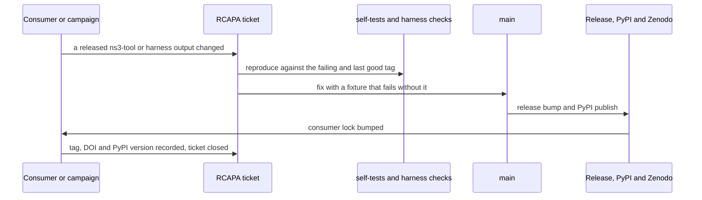

# RCAPA: regressions in a release of swarm-routing/ns3-tools

An **RCAPA** (root cause analysis with corrective and preventive actions) is
the full record of one **regression in a published release** of this
project: something that worked in a released version and broke after a
change. A bug or change that never reached a release needs none (an
ordinary `bug` issue is enough), and an upstream ns-3 bug is an `NS3-NNN` in
swarm-routing/ns3-tools. The org's rule and its decision table are in
[CONTRIBUTING.md, "RCAPA"](https://github.com/swarm-routing/.github/blob/main/CONTRIBUTING.md#rcapa)
([ADR-0003](https://github.com/swarm-routing/.github/blob/main/docs/adr/0003-rcapa-for-ns3-bugs-and-released-regressions.md)).
This page is the project's flow and its index.

## The flow for this project

This page covers ns3-tools' **own** code. Upstream ns-3 bugs keep their
register here: `NS3-NNN` in [`../ns3-bugs.md`](../ns3-bugs.md) with one RCAPA
each in [`../ns3-rcapa/`](../ns3-rcapa/README.md) (form *ns-3 bug (RCAPA)*,
labels `rcapa` and `ns3-upstream`, always required), and a defect in how we
carry a report upstream is a `PROC-NNN` there.

A **published release** of ns3-tools is a `v*` tag of this repository: its
GitHub release with the `routing-bench` tarball and the `ns3-tool` wheel and
sdist (`tools/release/dist.sh`), the `ns3-tools` package on PyPI
(`release.yml`'s `pypi` job), the release image (`image` job), archived on
Zenodo (concept DOI
[10.5281/zenodo.24136068](https://doi.org/10.5281/zenodo.24136068)).
AntHocNet pins a release in `ns3-tools.lock`. The CLI and marker contract v1
are frozen since v1.0.0 (`docs/markers.md`), so a changed marker line or reader
output against a release is a regression. A defect caught on `main` before
the next tag needs no RCAPA.

| | |
|---|---|
| Published as | `v*` tags: GitHub release (routing-bench tarball, wheel, sdist) + Zenodo DOI, `ns3-tools` on PyPI, the release image; pinned by AntHocNet's `ns3-tools.lock` |
| ID prefix | `NST-NNN` (ns3-tools' own code); `NS3-NNN` and `PROC-NNN` stay in [`../ns3-bugs.md`](../ns3-bugs.md) |
| Ticket | an issue in swarm-routing/ns3-tools, form *Regression in a release (RCAPA)*, title `[rcapa] NST-NNN <short description>`, labels `rcapa` and `bug` |
| Verified by | the reproducer against the failing tag and the last good one: `make check` (ruff, the Python self-tests), the readers byte-identical on `python/tests/fixtures/cells/` and on AntHocNet's corpus (`NS3_TOOL_CELLS`), `scenario_check` and `change_plan` verdicts equal to AntHocNet's, the harness suite and stock-arm checks of `ns3.yml`, `tools/checks/check-perf-markers.sh` for `##PERF##` |
| Corrective action | the fix PR with a fixture or self-test that fails without it; a marker change follows golden rule 11 (append only, or a schema version bump with the readers and benchmarks' parsers); then a release bump and the PyPI publish |
| Preventive action | the fixture, corpus case or harness check that would have caught it before the tag |
| Closes when | the fix is merged **and** a `v*` release carries it (tag, version DOI read from Zenodo, the PyPI version), and AntHocNet's lock bump is merged if it was affected |

## Index

| ID | RCAPA | RCAPA ticket | Fixed in |
|----|-------|--------------|----------|

## Adding one: the ticket first

1. Open the RCAPA ticket (the table above). `NNN` is the next free number in
   the index.
2. Copy [`_template.md`](_template.md) to `rcapa-<short-description>.md`
   (lowercase, hyphens: what breaks, not where it was found), and add its row
   to the index in the same pull request.
3. The ticket stays open until the corrective action is merged **and a
   release carries the fix**; record that release in the index.

## What an RCAPA answers

1. **What broke, in which release, and who did it touch?** The symptom, the
   releases that fail and the last that passes, the users, numbers or
   downstream pins it affects.
2. **How do I see it myself?** Exact commands, the release or commit, an
   image by tag and digest when one is involved, seeds, expected against
   actual.
3. **Why did it happen, and why did our checks let it into a release?** Five
   whys, each citing its evidence: a source line at a named commit, a log, a
   run, a comment. An answer without a source is a hypothesis and says so.
4. **What does it look like?** Mermaid diagrams: the failing call chain, the
   types or components involved.
5. **What did we do about it?** Corrective actions (the fix, its PR, the
   release that carries it) and preventive actions (the test or check that
   catches a recurrence). An action not done yet is an open issue, linked.
6. **When?** A dated timeline and every link.

## Writing one

- Every issue and PR reference is fully qualified: `swarm-routing/<repo>#N`,
  also for this repository's own items; an ns-3 item is a link whose text is
  `nsnam/ns-3-dev#N` to its full gitlab.com URL. Never a bare number with a
  hash. In a mermaid block, which cannot hold a hash, name the item in words.
- Mermaid: no HTML entities inside a block; write template arguments as
  words.
- An RCAPA is never deleted. Later findings update its status and timeline.
