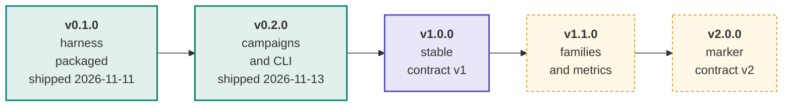
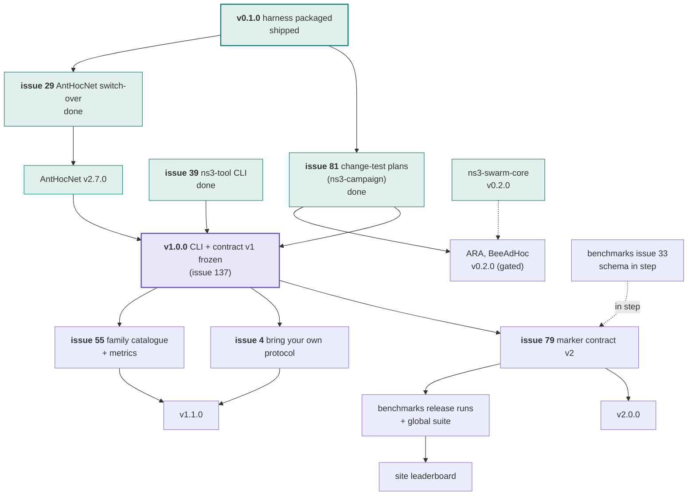

# Roadmap

The plan in one page. The live plan is this page plus the `release:` labels
below; issue state is always truer than a checked-in diagram. The ladder was
adopted by the maintainer on 2026-11-11 ("adopt the release ladder and replace
the phase-targets rule") and follows
[AntHocNet's roadmap](https://github.com/swarm-routing/AntHocNet/blob/main/docs/roadmap.md).
It was re-scoped by the maintainer on **2026-11-13** ("ns3-tools now, core
later"): *"ns3-tools v1.0.0 now: freeze today's CLI and marker contract v1,
the one AntHocNet and benchmarks already use; contract v2 becomes 2.0.0."*
AntHocNet already runs on this package (pinned in its `ns3-tools.lock`), so the
contract it uses is released as version 1 and shown as ready; what follows is
increments and later releases. This **supersedes the 2026-11-11 ladder**
(v0.3.0 contract v2 → v0.4.0 families and metrics → v1.0.0 contract v2 frozen
and the guide walked through): its v0.4.0 scope is now v1.1.0, its contract v2
is now v2.0.0, and v0.3.0 and v0.4.0 will not be released.
The cross-repo release train (which repository releases in which wave) is in the
[org ROADMAP](https://github.com/swarm-routing/.github/blob/main/ROADMAP.md).

## How this plan is tracked

Each issue a release gates carries that release's **`release:` label**, so every
column of this plan is a live query rather than a diagram that drifts:

| Release | Board |
|---|---|
| v0.1.0 | [`release:v0.1.0`](https://github.com/swarm-routing/ns3-tools/issues?q=is%3Aopen+label%3A%22release%3Av0.1.0%22) |
| v0.2.0 | [`release:v0.2.0`](https://github.com/swarm-routing/ns3-tools/issues?q=is%3Aopen+label%3A%22release%3Av0.2.0%22) |
| v1.0.0 | [`release:v1.0.0`](https://github.com/swarm-routing/ns3-tools/issues?q=is%3Aopen+label%3A%22release%3Av1.0.0%22) |
| v1.1.0 | [`release:v1.1.0`](https://github.com/swarm-routing/ns3-tools/issues?q=is%3Aopen+label%3A%22release%3Av1.1.0%22) |
| v2.0.0 | [`release:v2.0.0`](https://github.com/swarm-routing/ns3-tools/issues?q=is%3Aopen+label%3A%22release%3Av2.0.0%22) |
| all epics | [`epic`](https://github.com/swarm-routing/ns3-tools/issues?q=is%3Aopen+label%3Aepic) |

Only issues the ladder actually gates are labelled, one release label per issue.
The rest is unscheduled work that lands whenever it lands. Majors are reserved
for breaking changes; **1.0.0 is a stability promise**: from v1.0.0 the
`ns3-tool` CLI and marker contract v1 are frozen, which means (golden rule 11)
marker fields and CLI commands and options are only appended; removing one or
changing its meaning is a major release (the next one is v2.0.0, marker
contract v2). Additive work is a minor or a patch. The `release:v1.1.0` and
`release:v2.0.0` labels come from `swarm-routing/.github`'s `labels.json`
(swarm-routing/.github#211) and reach this repository with its `sync-labels`
run.

## Release ladder

Shipped releases are filled teal. **v0.1.0 shipped on 2026-11-11**
([release](https://github.com/swarm-routing/ns3-tools/releases/tag/v0.1.0),
Zenodo version DOI
[10.5281/zenodo.24136069](https://doi.org/10.5281/zenodo.24136069)), and
**v0.2.0 on 2026-11-13**
([release](https://github.com/swarm-routing/ns3-tools/releases/tag/v0.2.0),
Zenodo version DOI
[10.5281/zenodo.24189270](https://doi.org/10.5281/zenodo.24189270); from
v0.2.0 a release also publishes the image `ghcr.io/swarm-routing/ns3-tools`,
with rolling `latest` tags). v1.0.0 is next (purple): it adds no feature,
it declares today's CLI and contract v1 stable. Dashed amber releases are
planned and not started; v1.1.0 is additive, v2.0.0 is the next breaking
change.

## What blocks what

Solid arrows are hard dependencies; dashed are "informs". Nodes outside this
repository name their repository.

Cross-repo reading: every protocol pipeline needs v0.2.0 (it runs a paired
campaign end to end), so v0.2.0 gates the first gated protocol releases (ARA
and BeeAdHoc v0.2.0). v1.0.0 needs nothing new: AntHocNet already consumes the
harness and the readers at contract v1, so the release states what is in use.
v2.0.0 moves with
[benchmarks#33](https://github.com/swarm-routing/benchmarks/issues/33) and
feeds the benchmarks release runs and the site leaderboard; until it ships,
those read contract v1.

## What each release must show to ship

| Release | Exit criteria |
|---|---|
| **v0.1.0** (shipped 2026-11-11) | **The harness packaged.** [#26](https://github.com/swarm-routing/ns3-tools/issues/26): the `routing-bench` tarball and the `ns3-tool` wheel and sdist are published by a release run, with checksums, SBOM and attestations. Gated by the tag-push fix [#105](https://github.com/swarm-routing/ns3-tools/issues/105). Unblocked [#29](https://github.com/swarm-routing/ns3-tools/issues/29) (done) and AntHocNet v2.7.0. |
| **v0.2.0** (shipped 2026-11-13) | **Campaigns and CLI.** A protocol pipeline runs a paired campaign end to end. Scope, done: [#81](https://github.com/swarm-routing/ns3-tools/issues/81) (P1, change-test plans for any repository), [#39](https://github.com/swarm-routing/ns3-tools/issues/39) (the `ns3-tool` CLI), [#89](https://github.com/swarm-routing/ns3-tools/issues/89) (plan shows each arm's ns-3 version, image and commit), [#58](https://github.com/swarm-routing/ns3-tools/issues/58) (strict readers by default for verdicts), [#94](https://github.com/swarm-routing/ns3-tools/issues/94) (result cache keyed by every pinned input), [#152](https://github.com/swarm-routing/ns3-tools/issues/152) (a change-plan `reference:` protocol, so an anchor's verdict pairs two protocols within a cell; ARA's v0.2.0 anchor needs it), [#148](https://github.com/swarm-routing/ns3-tools/issues/148) (`collect` checks each cell's `##PROV## modules=` against one dependency set per campaign, replacing the protocol repositories' manual `grep`). |
| **v1.0.0** (next) | **Stable contract v1.** The `ns3-tool` CLI (`compare`, `sweep`, `diagnose`, `scaffold`, and the console scripts it keeps as aliases) and marker contract v1 as [`markers.md`](markers.md) documents it, the contract AntHocNet and `benchmarks` already use, are frozen: from here fields, commands and options are only appended, and a removal or a change of meaning is a major (golden rule 11; [`markers.md`](markers.md) "Stability"). Scope: [#137](https://github.com/swarm-routing/ns3-tools/issues/137) (the freeze and its policy written down in `markers.md` and the CLI's help; released through the reusable release workflow's `increment` input, swarm-routing/.github#211, with `.cz.toml`'s `major_version_zero` off). |
| **v1.1.0** | **Families and metrics**, additive (the 2026-11-11 ladder's v0.4.0). The family catalogue and the survivorship-safe metrics every arm shares. Scope: [#55](https://github.com/swarm-routing/ns3-tools/issues/55) (family catalogue), [#22](https://github.com/swarm-routing/ns3-tools/issues/22) (jitter, delay CDF, delay at matched PDR), [#8](https://github.com/swarm-routing/ns3-tools/issues/8) (oracle exact only on wired topologies), [#25](https://github.com/swarm-routing/ns3-tools/issues/25) (satellite validation anchors), [#5](https://github.com/swarm-routing/ns3-tools/issues/5) (satellite harnesses on the arm registry), [#40](https://github.com/swarm-routing/ns3-tools/issues/40) (probes as their own module, with a non-intrusion test), [#3](https://github.com/swarm-routing/ns3-tools/issues/3) (readers as an installable package with a versioned contract), [#128](https://github.com/swarm-routing/ns3-tools/issues/128) and [#150](https://github.com/swarm-routing/ns3-tools/issues/150) (scripted node and link failures, identical for every arm; #150 drives swarm-core's lifecycle helper, so check one does not supersede the other). Also the additive items of the old v0.3.0 list, none of which changes a v1 field: [#96](https://github.com/swarm-routing/ns3-tools/issues/96) (perf, output byte-identical), [#95](https://github.com/swarm-routing/ns3-tools/issues/95) (runner-minute estimates and budget guard), [#91](https://github.com/swarm-routing/ns3-tools/issues/91) (the rest of per-arm cost: state footprint, verdicts; `##PERF##` is already a v1 line, see `markers.md` "Why this is not a version bump") and [#83](https://github.com/swarm-routing/ns3-tools/issues/83) (one plan schema for release and change-test plans, with today's plans still valid; if they cannot stay valid, it moves to v2.0.0). And **an outside user follows the guide ([#4](https://github.com/swarm-routing/ns3-tools/issues/4)) from zero to a gated comparison**, moved here from the old v1.0.0: the guide documents a stable interface rather than defining it, so it does not gate the freeze, and AntHocNet already runs its comparisons on v1. |
| **v2.0.0** | **Marker contract v2**, breaking (the 2026-11-11 ladder's v0.3.0). Readers refuse unknown contracts; outputs are byte-identical apart from the new fields; `benchmarks`' schema moves in step ([benchmarks#33](https://github.com/swarm-routing/benchmarks/issues/33)); v1 readers' behaviour on v2 output and the migration are written down. Scope: [#79](https://github.com/swarm-routing/ns3-tools/issues/79) (routing-bench prints `##HARNESS##`, `##BENCH##`/`##DIAG##` itself, versioned), [#93](https://github.com/swarm-routing/ns3-tools/issues/93) (declarative `--stats`, scalars into the harness's `##DIAG##`), [#23](https://github.com/swarm-routing/ns3-tools/issues/23) (validate the drop-cause identity under TCP, then un-suppress `##DROPID##`: a marker name v1's validator does not know). |

Issue state on 2026-11-13 (read from the tracker): v0.1.0's [#26](https://github.com/swarm-routing/ns3-tools/issues/26)
and [#105](https://github.com/swarm-routing/ns3-tools/issues/105) are closed as
completed, and so is [#29](https://github.com/swarm-routing/ns3-tools/issues/29)
(AntHocNet's switch-over: AntHocNet consumes the harness and readers from
here). Every issue of the v0.2.0 scope (#81, #39, #89, #58, #94, #152 and
[#148](https://github.com/swarm-routing/ns3-tools/issues/148)) is closed as
completed, and v0.2.0 shipped from them;
[#155](https://github.com/swarm-routing/ns3-tools/issues/155) (finishing #94 and
#89 across repositories, no `release:` label) is closed as completed too.
v1.0.0's [#137](https://github.com/swarm-routing/ns3-tools/issues/137) closes
when the freeze merges; v1.0.0 is then cut on the maintainer's request, and its
release and Zenodo DOI are recorded above with the others. The later releases' scope is open; until the
`release:v1.1.0` and `release:v2.0.0` labels reach this repository, its issues
still carry the old `release:v0.3.0` and `release:v0.4.0` labels, and are
relabelled as the rows above say once they do.

## Infrastructure track

Rides along with the releases, is labelled, and never gates one: CI, formatting
(the harness keeps AntHocNet's style until a restyle PR adopts the org
`.clang-format`), release mechanics (the v0.1.0 tag-push fix [#105](https://github.com/swarm-routing/ns3-tools/issues/105) was the one that gated a release), and the temporary
`aodv` arm check on `ns3-dev:3.48` (ns3-containers#35).

## After 1.0

Themed lines after v1.0.0, shared with the [org ROADMAP](https://github.com/swarm-routing/.github/blob/main/ROADMAP.md)'s
*After 1.0* list. **None of them gates v1.0.0, v1.1.0 or v2.0.0**: their issues
carry no `release:` label until this ladder schedules them. Every arm clears the
three gates (a fidelity sheet from its paper, the per-PR delivery smoke, and an
anchor reproducing the paper's own trend) before a number counts.

| Line | Theme | Issues here |
|---|---|---|
| **1.1** | **Comparators** (epic [#15](https://github.com/swarm-routing/ns3-tools/issues/15)) | the secure arms SAODV [#17](https://github.com/swarm-routing/ns3-tools/issues/17), SEAD [#18](https://github.com/swarm-routing/ns3-tools/issues/18) and TAODV [#19](https://github.com/swarm-routing/ns3-tools/issues/19), on the crypto cost model [#16](https://github.com/swarm-routing/ns3-tools/issues/16); the multi-agent DRL arm [#20](https://github.com/swarm-routing/ns3-tools/issues/20), gated (disjoint training and test seeds, a held-out family, the training budget reported); the DTN arm for the disaster family [#21](https://github.com/swarm-routing/ns3-tools/issues/21); AntHocNet's vendored AOMDV and GPSR promoted to `ns3/arms/` (epic [#34](https://github.com/swarm-routing/ns3-tools/issues/34), [#35](https://github.com/swarm-routing/ns3-tools/issues/35), [#36](https://github.com/swarm-routing/ns3-tools/issues/36)) |
| **1.2** | **Network families** (epic [#43](https://github.com/swarm-routing/ns3-tools/issues/43)) | the substrates [#44](https://github.com/swarm-routing/ns3-tools/issues/44)–[#53](https://github.com/swarm-routing/ns3-tools/issues/53); the tactical narrowband cell [#24](https://github.com/swarm-routing/ns3-tools/issues/24). The public-safety fallback cell [#48](https://github.com/swarm-routing/ns3-tools/issues/48) needs `lte` and `buildings` in the images first ([ns3-containers#63](https://github.com/swarm-routing/ns3-containers/issues/63)) |
| **2.0** | **Security** | protocol-agnostic adversary nodes (wormhole, rushing, Sybil) [#37](https://github.com/swarm-routing/ns3-tools/issues/37) and packet droppers (blackhole, grayhole) [#127](https://github.com/swarm-routing/ns3-tools/issues/127), which the secure swarm variants ([ARA#9](https://github.com/swarm-routing/ARA/issues/9), [ARA#10](https://github.com/swarm-routing/ARA/issues/10), [BeeAdHoc#9](https://github.com/swarm-routing/BeeAdHoc/issues/9)) and the secure arms above are measured against |

A line's number names a theme, not this package's next version: an additive arm
or substrate is a minor release here; only a breaking change takes a major. So
the *1.1* line is not the v1.1.0 release above, and the *2.0* line is not
v2.0.0 (marker contract v2).

## Deliberate non-goals

Not for 1.0.0; each lands after it, in a line of [After 1.0](#after-10):

- **Substrates**, the epic [#43](https://github.com/swarm-routing/ns3-tools/issues/43) and its children (cognitive radio [#53](https://github.com/swarm-routing/ns3-tools/issues/53) and the rest): the ns-3 pieces new network types need.
- **Comparator arms**, the epic [#15](https://github.com/swarm-routing/ns3-tools/issues/15) (DTN [#21](https://github.com/swarm-routing/ns3-tools/issues/21) among them), and the arm promotion epic [#34](https://github.com/swarm-routing/ns3-tools/issues/34).
- **Adversary nodes**, [#37](https://github.com/swarm-routing/ns3-tools/issues/37): wormhole, rushing and Sybil attackers, and [#127](https://github.com/swarm-routing/ns3-tools/issues/127): blackhole and grayhole packet droppers.
- A version ladder for repositories that do not release a package: `benchmarks`, `ns3-containers`, the site, `skills` and `.github` follow the org ROADMAP's waves instead.

## See also

- [Org ROADMAP](https://github.com/swarm-routing/.github/blob/main/ROADMAP.md): the release train and the epics.
- [CONTRIBUTING](https://github.com/swarm-routing/.github/blob/main/CONTRIBUTING.md): invariants, labels, issue shape, "Cutting a release".
- [AntHocNet's roadmap](https://github.com/swarm-routing/AntHocNet/blob/main/docs/roadmap.md): the model this page follows.
- [`markers.md`](markers.md): the marker-line contract v1.0.0 freezes and v2.0.0 revises.
