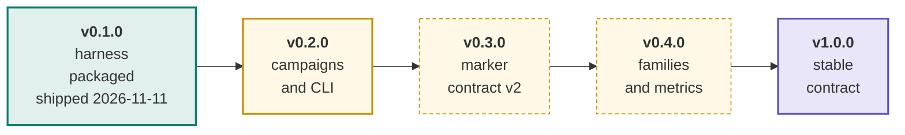
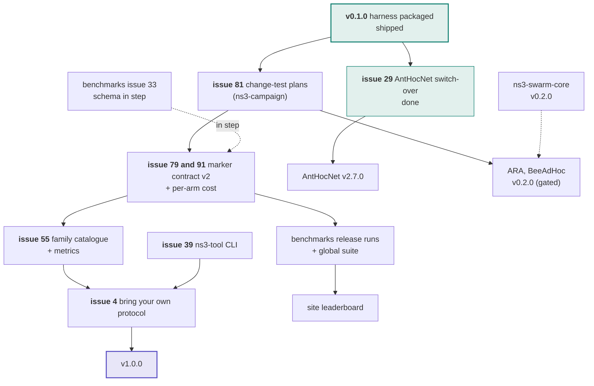

# Roadmap

The plan in one page. The live plan is this page plus the `release:` labels
below; issue state is always truer than a checked-in diagram. The ladder was
adopted by the maintainer on 2026-11-11 ("adopt the release ladder and replace
the phase-targets rule") and follows
[AntHocNet's roadmap](https://github.com/swarm-routing/AntHocNet/blob/main/docs/roadmap.md).
The cross-repo release train (which repository releases in which wave) is in the
[org ROADMAP](https://github.com/swarm-routing/.github/blob/main/ROADMAP.md).

## How this plan is tracked

Each issue a release gates carries that release's **`release:` label**, so every
column of this plan is a live query rather than a diagram that drifts:

| Release | Board |
|---|---|
| v0.1.0 | [`release:v0.1.0`](https://github.com/swarm-routing/ns3-tools/issues?q=is%3Aopen+label%3A%22release%3Av0.1.0%22) |
| v0.2.0 | [`release:v0.2.0`](https://github.com/swarm-routing/ns3-tools/issues?q=is%3Aopen+label%3A%22release%3Av0.2.0%22) |
| v0.3.0 | [`release:v0.3.0`](https://github.com/swarm-routing/ns3-tools/issues?q=is%3Aopen+label%3A%22release%3Av0.3.0%22) |
| v0.4.0 | [`release:v0.4.0`](https://github.com/swarm-routing/ns3-tools/issues?q=is%3Aopen+label%3A%22release%3Av0.4.0%22) |
| v1.0.0 | [`release:v1.0.0`](https://github.com/swarm-routing/ns3-tools/issues?q=is%3Aopen+label%3A%22release%3Av1.0.0%22) |
| all epics | [`epic`](https://github.com/swarm-routing/ns3-tools/issues?q=is%3Aopen+label%3Aepic) |

Only issues the ladder actually gates are labelled, one release label per issue.
The rest is unscheduled work that lands whenever it lands. Majors are reserved
for breaking changes; **1.0.0 is a stability promise**.

## Release ladder

Shipped releases are filled teal. **v0.1.0 shipped on 2026-11-11**
([release](https://github.com/swarm-routing/ns3-tools/releases/tag/v0.1.0),
Zenodo version DOI
[10.5281/zenodo.24136069](https://doi.org/10.5281/zenodo.24136069)). v0.2.0 is
next (amber, solid). Dashed amber releases are planned and not started.

## What blocks what

Solid arrows are hard dependencies; dashed are "informs". Nodes outside this
repository name their repository.

Cross-repo reading: every protocol pipeline needs v0.2.0 (it runs a paired
campaign end to end), so v0.2.0 gates the first gated protocol releases (ARA
and BeeAdHoc v0.2.0); v0.3.0 moves with
[benchmarks#33](https://github.com/swarm-routing/benchmarks/issues/33) and
feeds the benchmarks release runs and the site leaderboard.

## What each release must show to ship

| Release | Exit criteria |
|---|---|
| **v0.1.0** (shipped 2026-11-11) | **The harness packaged.** [#26](https://github.com/swarm-routing/ns3-tools/issues/26): the `routing-bench` tarball and the `ns3-tool` wheel and sdist are published by a release run, with checksums, SBOM and attestations. Gated by the tag-push fix [#105](https://github.com/swarm-routing/ns3-tools/issues/105). Unblocked [#29](https://github.com/swarm-routing/ns3-tools/issues/29) (done) and AntHocNet v2.7.0. |
| **v0.2.0** | **Campaigns and CLI.** A protocol pipeline runs a paired campaign end to end. Scope: [#81](https://github.com/swarm-routing/ns3-tools/issues/81) (P1, change-test plans for any repository), [#39](https://github.com/swarm-routing/ns3-tools/issues/39) (the `ns3-tool` CLI), [#89](https://github.com/swarm-routing/ns3-tools/issues/89) (plan shows each arm's ns-3 version, image and commit), [#58](https://github.com/swarm-routing/ns3-tools/issues/58) (strict readers by default for verdicts), [#94](https://github.com/swarm-routing/ns3-tools/issues/94) (result cache keyed by every pinned input). |
| **v0.3.0** | **Marker contract v2.** Readers refuse unknown contracts; outputs are byte-identical apart from the new fields; `benchmarks`' schema moves in step ([benchmarks#33](https://github.com/swarm-routing/benchmarks/issues/33)). Scope: [#79](https://github.com/swarm-routing/ns3-tools/issues/79) (routing-bench prints `##BENCH##`/`##DIAG##` itself, versioned), [#91](https://github.com/swarm-routing/ns3-tools/issues/91) (per-arm cost; the rest: state footprint, verdicts), [#93](https://github.com/swarm-routing/ns3-tools/issues/93) (declarative `--stats`), [#96](https://github.com/swarm-routing/ns3-tools/issues/96) (perf, output byte-identical), [#95](https://github.com/swarm-routing/ns3-tools/issues/95) (runner-minute estimates and budget guard), [#83](https://github.com/swarm-routing/ns3-tools/issues/83) (one plan schema for release and change-test plans). |
| **v0.4.0** | **Families and metrics.** The family catalogue and the survivorship-safe metrics every arm shares. Scope: [#55](https://github.com/swarm-routing/ns3-tools/issues/55) (family catalogue), [#22](https://github.com/swarm-routing/ns3-tools/issues/22) (jitter, delay CDF, delay at matched PDR), [#8](https://github.com/swarm-routing/ns3-tools/issues/8) (oracle exact only on wired topologies), [#25](https://github.com/swarm-routing/ns3-tools/issues/25) (satellite validation anchors), [#5](https://github.com/swarm-routing/ns3-tools/issues/5) (satellite harnesses on the arm registry), [#40](https://github.com/swarm-routing/ns3-tools/issues/40) (probes as their own module, with a non-intrusion test), [#3](https://github.com/swarm-routing/ns3-tools/issues/3) (readers as an installable package with a versioned contract), [#4](https://github.com/swarm-routing/ns3-tools/issues/4) (bring your own protocol). |
| **v1.0.0** | **Stable contract.** Marker contract v2 and the CLI frozen; an outside user follows the guide ([#4](https://github.com/swarm-routing/ns3-tools/issues/4)) from zero to a gated comparison. A 1.0.0 release needs the reusable release workflow's `increment` input (MAJOR), a new ticket in `swarm-routing/.github`. |

Issue state on 2026-11-11, after v0.1.0 shipped: [#29](https://github.com/swarm-routing/ns3-tools/issues/29)
(AntHocNet's switch-over: AntHocNet consumes the harness and readers from here)
is closed as completed, so it left the v0.2.0 scope. [#26](https://github.com/swarm-routing/ns3-tools/issues/26)
and [#105](https://github.com/swarm-routing/ns3-tools/issues/105) are still open
although the release they gated is published; closing them is a maintainer
step, so the `release:v0.1.0` board still lists them until then. Every other
cited issue (#81, #39, #89, #58, #94 and the later releases' scope) is open.

## Infrastructure track

Rides along with the releases, is labelled, and never gates one: CI, formatting
(the harness keeps AntHocNet's style until a restyle PR adopts the org
`.clang-format`), release mechanics (the v0.1.0 tag-push fix [#105](https://github.com/swarm-routing/ns3-tools/issues/105) was the one that gated a release), and the temporary
`aodv` arm check on `ns3-dev:3.48` (ns3-containers#35).

## After 1.0

Themed lines after v1.0.0, shared with the [org ROADMAP](https://github.com/swarm-routing/.github/blob/main/ROADMAP.md)'s
*After 1.0* list. **None of them gates any release before 1.0**: their issues
carry no `release:` label until this ladder schedules them. Every arm clears the
three gates (a fidelity sheet from its paper, the per-PR delivery smoke, and an
anchor reproducing the paper's own trend) before a number counts.

| Line | Theme | Issues here |
|---|---|---|
| **1.1** | **Comparators** (epic [#15](https://github.com/swarm-routing/ns3-tools/issues/15)) | the secure arms SAODV [#17](https://github.com/swarm-routing/ns3-tools/issues/17), SEAD [#18](https://github.com/swarm-routing/ns3-tools/issues/18) and TAODV [#19](https://github.com/swarm-routing/ns3-tools/issues/19), on the crypto cost model [#16](https://github.com/swarm-routing/ns3-tools/issues/16); the multi-agent DRL arm [#20](https://github.com/swarm-routing/ns3-tools/issues/20), gated (disjoint training and test seeds, a held-out family, the training budget reported); the DTN arm for the disaster family [#21](https://github.com/swarm-routing/ns3-tools/issues/21); AntHocNet's vendored AOMDV and GPSR promoted to `ns3/arms/` (epic [#34](https://github.com/swarm-routing/ns3-tools/issues/34), [#35](https://github.com/swarm-routing/ns3-tools/issues/35), [#36](https://github.com/swarm-routing/ns3-tools/issues/36)) |
| **1.2** | **Network families** (epic [#43](https://github.com/swarm-routing/ns3-tools/issues/43)) | the substrates [#44](https://github.com/swarm-routing/ns3-tools/issues/44)–[#53](https://github.com/swarm-routing/ns3-tools/issues/53); the tactical narrowband cell [#24](https://github.com/swarm-routing/ns3-tools/issues/24). The public-safety fallback cell [#48](https://github.com/swarm-routing/ns3-tools/issues/48) needs `lte` and `buildings` in the images first ([ns3-containers#63](https://github.com/swarm-routing/ns3-containers/issues/63)) |
| **2.0** | **Security** | protocol-agnostic adversary nodes (wormhole, rushing, Sybil) [#37](https://github.com/swarm-routing/ns3-tools/issues/37), which the secure swarm variants ([ARA#9](https://github.com/swarm-routing/ARA/issues/9), [ARA#10](https://github.com/swarm-routing/ARA/issues/10), [BeeAdHoc#9](https://github.com/swarm-routing/BeeAdHoc/issues/9)) and the secure arms above are measured against |

A line's number names a theme, not this package's next version: an additive arm
or substrate is a minor release here; only a breaking change takes a major.

## Deliberate non-goals

Not for 1.0.0; each lands after it, in a line of [After 1.0](#after-10):

- **Substrates**, the epic [#43](https://github.com/swarm-routing/ns3-tools/issues/43) and its children (cognitive radio [#53](https://github.com/swarm-routing/ns3-tools/issues/53) and the rest): the ns-3 pieces new network types need.
- **Comparator arms**, the epic [#15](https://github.com/swarm-routing/ns3-tools/issues/15) (DTN [#21](https://github.com/swarm-routing/ns3-tools/issues/21) among them), and the arm promotion epic [#34](https://github.com/swarm-routing/ns3-tools/issues/34).
- **Adversary nodes**, [#37](https://github.com/swarm-routing/ns3-tools/issues/37): wormhole, rushing and Sybil attackers.
- A version ladder for repositories that do not release a package: `benchmarks`, `ns3-containers`, the site, `skills` and `.github` follow the org ROADMAP's waves instead.

## See also

- [Org ROADMAP](https://github.com/swarm-routing/.github/blob/main/ROADMAP.md): the release train and the epics.
- [CONTRIBUTING](https://github.com/swarm-routing/.github/blob/main/CONTRIBUTING.md): invariants, labels, issue shape, "Cutting a release".
- [AntHocNet's roadmap](https://github.com/swarm-routing/AntHocNet/blob/main/docs/roadmap.md): the model this page follows.
- [`markers.md`](markers.md): the marker-line contract that v0.3.0 revises.
